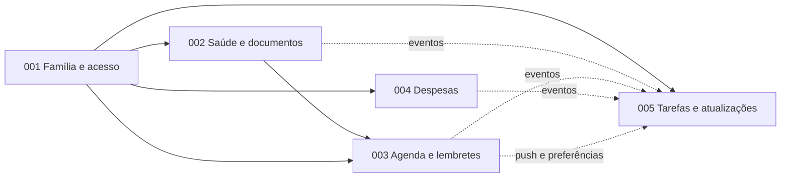

# Mapa de Features e Rastreabilidade

## Módulos, features e dependências

| Módulo | Feature | Pasta | Depende de | Prioridade de entrega |
|---|---|---|---|---|
| Família e tarefas | 001 Família e acesso | `specs/001-familia-e-acesso/` | — | 1º |
| Saúde e documentos | 002 Saúde e documentos | `specs/002-saude-e-documentos/` | 001 | 2º |
| Agenda e lembretes | 003 Agenda e lembretes | `specs/003-agenda-e-lembretes/` | 001, 002 | 3º |
| Finanças | 004 Registro de despesas | `specs/004-registro-de-despesas/` | 001 (002 e 003 opcionais) | 4º (pode andar em paralelo à 003) |
| Família e tarefas | 005 Tarefas e atualizações | `specs/005-tarefas-e-atualizacoes/` | 001; recebe eventos de 002 a 004 | 5º (o `log_activity()` deve existir desde a 001) |

**Ordem recomendada de implementação:** 001 → 002 → 003 → 004 → 005, com a tabela `activity_log` e a função `log_activity()` criadas já na 001 (migração base), para que todas as features nasçam registrando no feed.

## Rastreabilidade: Value Proposition Canvas → especificações

### Produtos e serviços

| Produto/serviço do canvas | Onde está |
|---|---|
| Aplicativo de gestão do cuidado com idosos | Todas as features |
| Agenda compartilhada de consultas, exames e medicamentos | 003: FR-001 a FR-015; RN-AGE-01 a 18 |
| Armazenamento de receitas, exames e documentos médicos | 002: FR-001 a FR-004, FR-011; RN-SAU-08, 12 |
| Controle de despesas do cuidado | 004: FR-001 a FR-007; RN-DES-01 a 14 |
| Gerenciamento de familiares e responsáveis | 001: FR-006 a FR-011; RN-FAM-04 a 06; 005: FR-001, FR-007; RN-TAR-02, 08 |

### Aliviadores de dores

| Aliviador | Onde está |
|---|---|
| Centraliza informações médicas, financeiras e de cuidados em um único lugar | 002, 004 e a tela "Hoje" (003: História 3) |
| Lembretes de consultas, exames e medicamentos | 003: RN-AGE-03, 07 a 09, 13; 002: RN-SAU-09 |
| Compartilhamento de atualizações entre familiares | 005: FR-004, FR-008, FR-009; RN-TAR-05 a 07, 09 |
| Organiza e distribui responsabilidades do cuidado | 003: RN-AGE-04, 14; 005: FR-001, FR-002, FR-007; RN-TAR-02, 08 |
| Registro e acompanhamento de gastos | 004: FR-005, FR-006; RN-DES-10 |

### Criadores de ganhos

| Ganho | Onde está |
|---|---|
| Organização e acesso rápido a todas as informações do idoso | 002: SC-001, História 6; 003: História 3 |
| Maior colaboração entre os familiares | 001: Histórias 2 e 3; 005: Histórias 1 e 5 |
| Acompanhamento da rotina de cuidados, mesmo à distância | 003: RN-AGE-07; 005: Histórias 2 e 4 |
| Transparência no controle de despesas | 004: RN-DES-04, 05, 07, 13 |
| Mais tranquilidade e segurança no cuidado | 002: História 5 (ficha de emergência); 003: RN-AGE-08, 09, 13 |

### Dores do cliente

| Dor | Resposta | Onde está |
|---|---|---|
| Informações espalhadas (papel, WhatsApp, e-mail) | Documentos e histórico organizados por idoso | 002 |
| Falhas na comunicação entre familiares | Feed, comentários e notificações | 005 |
| Esquecimento de consultas, exames e horários de medicamentos | Agenda, doses, lembretes e escalonamento | 003 |
| Sobrecarga de um único familiar | Tarefas, acompanhantes e divisão do cuidado | 003, 005 |
| Dificuldade para acompanhar e dividir os gastos | Registro de despesas com relatórios por pagador (**divisão fora do MVP**) | 004 |

### Tarefas do cliente

| Tarefa | Onde está |
|---|---|
| Organizar consultas, exames e medicamentos do idoso | 003 |
| Compartilhar informações e responsabilidades entre familiares | 001, 005 |
| Acompanhar e controlar despesas (farmácia, consultas, transporte) | 004 (categorias padrão em FR-002) |
| Manter histórico de saúde e documentos organizados | 002 |
| Monitorar a rotina e as necessidades do idoso | 003 (Hoje), 005 (feed, registro do dia) |

## Business Model Canvas (Sebrae) — o que entra e o que fica de fora

| Bloco do canvas | No MVP | Fora do MVP |
|---|---|---|
| Segmento de mercado: famílias de idosos | Usuário principal é o familiar cuidador (001) | Cuidador profissional, instituições |
| Proposta de valor: centralizar finanças, familiares, exames, receitas, médicos | 001 a 005 | — |
| Canais: digital, marketing digital, locais relacionados | Deep link de convite para crescimento orgânico (001) | Campanhas e parcerias com clínicas |
| Relacionamento: digital | App e notificações | Suporte dedicado, comunidade |
| Fontes de renda: assinatura, parcerias | — | Tudo (monetização fora do MVP) |
| Recursos e atividades-chave: aplicativo, conteúdos | Aplicativo | Conteúdos sobre gestão do cuidado |
| Parceiros-chave | — | Centros de cuidados, clínicas, médicos, influenciadores |
| Estrutura de custos: marketing, infraestrutura | Infraestrutura gerenciada (Supabase, Expo) | — |

## Contagem de regras por feature

| Feature | Prefixo | Regras de negócio |
|---|---|---|
| 001 | RN-FAM | 16 |
| 002 | RN-SAU | 16 |
| 003 | RN-AGE | 19 |
| 004 | RN-DES | 14 |
| 005 | RN-TAR | 15 |
| **Total** | | **80** |

## Pontos em aberto consolidados

Cada spec lista em "Decisões assumidas e pontos em aberto" as hipóteses que precisam de confirmação do dono do produto. As mais importantes:

1. **Uma família por usuário** (001).
2. **Textos e prazos jurídicos**: consentimento, retenção, validade de receita (001, 002, 005).
3. **Tempos de escalonamento de doses** (30/60/120 min) e padrão de aviso aos demais membros (003).
4. **Leitor vê valores das despesas** (004).
5. **Dados opcionais sensíveis** do idoso: CPF e cartão SUS (001).
6. **Menções "@" e comentários** no MVP ou depois (005).
