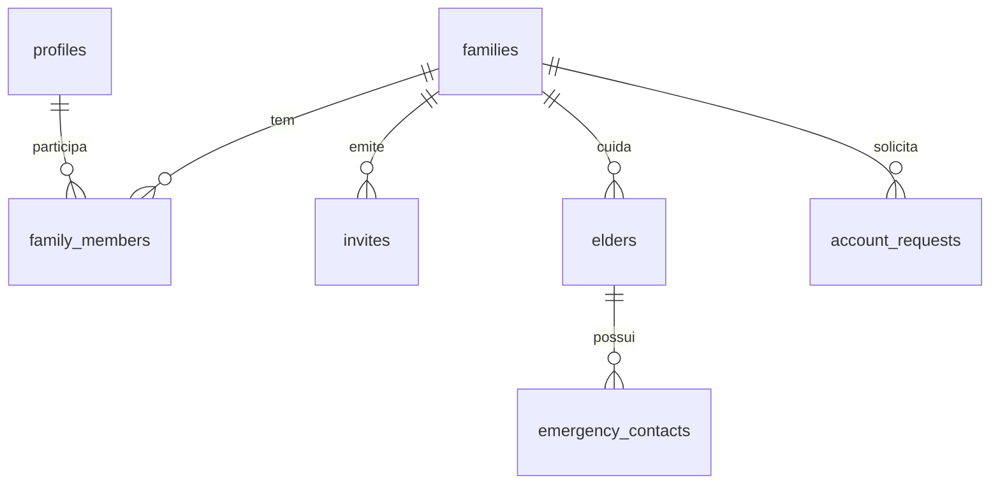

# Modelo de Dados: Família e Acesso

Convenções valendo para todo o MVP:
- Chaves primárias `uuid` (`gen_random_uuid()`).
- Toda tabela de negócio tem `family_id` (isolamento), `created_at`, `created_by`, `updated_at`, `updated_by` e, quando permite exclusão, `deleted_at` (lixeira de 30 dias).
- Valores monetários em centavos (`integer`/`bigint`). Datas e horas em `timestamptz` (UTC).
- Nomes de tabela em inglês, rótulos em PT-BR na interface (ver glossário).

## Tabelas

### `profiles`
| Coluna | Tipo | Regra |
|---|---|---|
| id | uuid PK, FK `auth.users` | |
| full_name | text NOT NULL | 2 a 120 caracteres |
| terms_version | text NOT NULL | versão aceita (FR-002) |
| terms_accepted_at | timestamptz NOT NULL | |
| adult_declared_at | timestamptz NOT NULL | RN-FAM-15 |
| biometric_lock | boolean default false | FR-016 |
| deleted_at | timestamptz | conta excluída; autoria vira "Ex-membro" (RN-FAM-11) |

### `families`
| Coluna | Tipo | Regra |
|---|---|---|
| id | uuid PK | |
| name | text NOT NULL | 2 a 80 caracteres |
| timezone | text NOT NULL default `America/Sao_Paulo` | |
| status | enum `active`, `deletion_scheduled` | |
| deletion_scheduled_at | timestamptz | purge após 30 dias (RN-FAM-12) |

### `family_members`
| Coluna | Tipo | Regra |
|---|---|---|
| family_id | uuid FK | |
| user_id | uuid FK `profiles` | **UNIQUE (user_id) WHERE status = 'active'** garante RN-FAM-01 |
| role | enum `admin`, `member`, `reader` | RN-FAM-04 |
| status | enum `active`, `removed`, `left` | |
| joined_at, ended_at | timestamptz | |

Restrição RN-FAM-03: gatilho `BEFORE UPDATE/DELETE` impede que o número de Admins ativos da família chegue a zero. Limite de 10 membros ativos (RN-FAM-05) por gatilho.

### `invites`
| Coluna | Tipo | Regra |
|---|---|---|
| id | uuid PK | |
| family_id | uuid FK | |
| role | enum | papel concedido |
| token_hash | text UNIQUE | só o hash é guardado (RN-FAM-06) |
| invitee_email | text | opcional, informativo |
| expires_at | timestamptz | `created_at + 7 dias` |
| status | enum `pending`, `used`, `expired`, `revoked` | |
| used_by | uuid FK `profiles` | |
| used_at | timestamptz | |

Limite de 10 convites pendentes por família (RN-FAM-05).

### `elders`
| Coluna | Tipo | Regra |
|---|---|---|
| id | uuid PK | |
| family_id | uuid FK | |
| full_name | text NOT NULL | |
| nickname | text | como a família chama |
| birth_date | date NOT NULL | |
| sex | enum `f`, `m`, `other`, `unspecified` | opcional |
| photo_path | text | Storage privado |
| blood_type | enum (A+ … O-) | opcional |
| health_plan_name, health_plan_number | text | opcionais |
| sus_card | text | opcional (ponto em aberto 5) |
| cpf | text | opcional, criptografado em coluna (ponto em aberto 5) |
| status | enum `active`, `archived` | RN-FAM-10 |
| archived_at, archive_reason | timestamptz, text | |
| authorization_by | uuid FK | RN-FAM-07 |
| authorization_at | timestamptz NOT NULL | |
| authorization_text_version | text NOT NULL | versão do texto aceito |

Limite de 5 idosos ativos por família (RN-FAM-05).

### `emergency_contacts`
| Coluna | Tipo | Regra |
|---|---|---|
| id | uuid PK | |
| elder_id | uuid FK | |
| family_id | uuid FK | denormalizado para RLS |
| name | text NOT NULL | |
| relationship | text NOT NULL | |
| phone | text NOT NULL | formato E.164 |
| position | smallint | 1 a 3 (RN-FAM-09) |

### `account_requests`
Pedidos assíncronos de exportação e exclusão: `id`, `family_id`, `type` (`export`, `deletion`), `requested_by`, `status`, `result_path`, `expires_at`, `created_at`.

### `login_attempts`
`email_hash`, `failed_count`, `locked_until`. Apoia RN-FAM-14.

## Diagrama

## Políticas RLS (resumo)

Função auxiliar `current_family_role(family_id)` devolve o papel ativo do `auth.uid()` ou nulo.

| Tabela | SELECT | INSERT/UPDATE | DELETE |
|---|---|---|---|
| families | membro ativo | Admin (nome, fuso) | nenhuma (usa exclusão agendada) |
| family_members | membro ativo da família | só via funções RPC | nenhuma |
| invites | Admin | só via RPC | nenhuma |
| elders | membro ativo (inclui Leitor) | Admin ou Membro; arquivar só Admin | nenhuma |
| emergency_contacts | membro ativo | Admin ou Membro | Admin ou Membro |
| profiles | o próprio; nome visível a membros da mesma família | o próprio | nenhuma |

Toda tabela que ganhar `family_id` nas features seguintes deve seguir o mesmo padrão e ter teste pgTAP de isolamento entre duas famílias.
