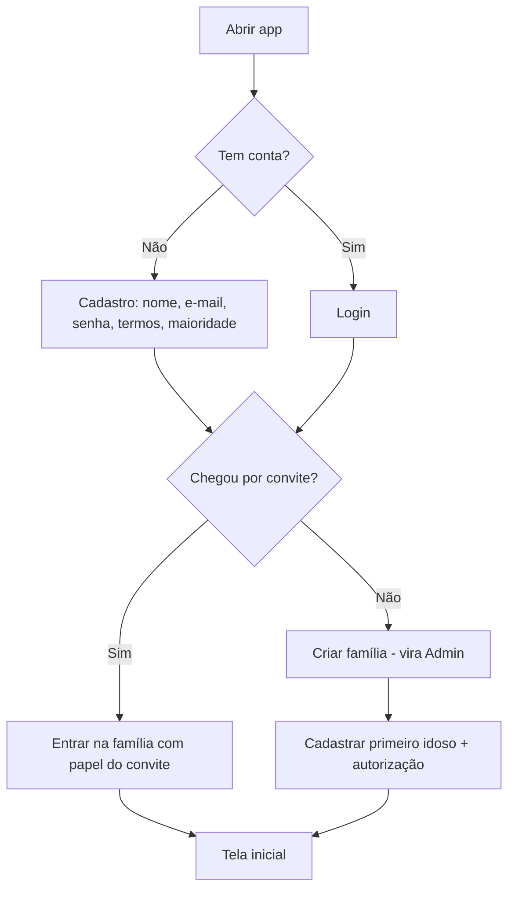
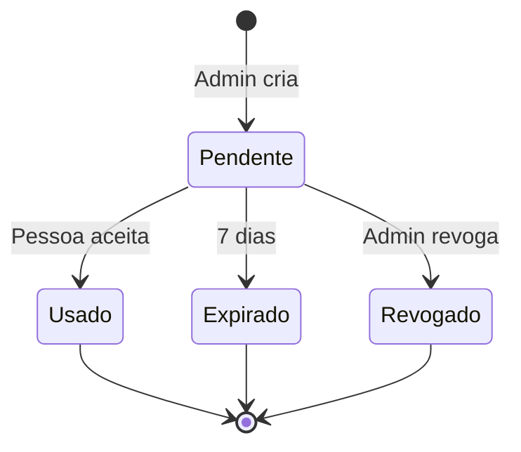
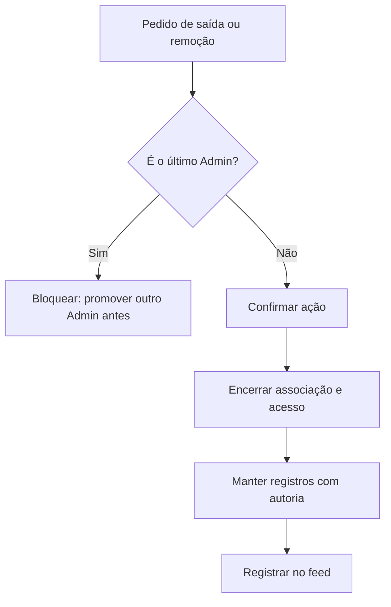

# Especificação: Família e Acesso

**Branch**: `001-familia-e-acesso` | **Criada**: 2026-11-13 | **Status**: Rascunho para revisão

**Entrada**: "Famílias, membros, papéis, convites e perfis de idosos" — base de todas as outras features. Ver `docs/produto/visao.md` e `docs/produto/glossario.md`.

## Cenários de Usuário e Testes *(obrigatório)*

### História 1 — Criar a família e cadastrar o primeiro idoso (Prioridade: P1)

Uma pessoa baixa o app, cria a conta, cria a família e cadastra o idoso de quem cuida. Ao final, vê a tela inicial já com o idoso.

**Por que P1:** sem conta, família e idoso, nenhuma outra feature funciona.

**Teste independente:** instalar o app, criar conta, criar família e cadastrar um idoso. A tela inicial mostra o idoso e o usuário aparece como Admin.

**Cenários de aceite:**

1. **Dado** que não tenho conta, **quando** informo nome, e-mail e senha válidos e aceito os termos, **então** a conta é criada e sou levado a criar uma família.
2. **Dado** que criei a conta, **quando** dou um nome à família (ex.: "Família Silva"), **então** a família é criada e eu sou o Admin.
3. **Dado** que sou Admin de uma família sem idosos, **quando** cadastro um idoso com nome e data de nascimento e confirmo que tenho autorização para registrar os dados, **então** o perfil é criado e a autorização fica registrada com data e autor.
4. **Dado** que tento cadastrar um idoso sem marcar a autorização, **quando** toco em "Salvar", **então** o app não salva e explica o motivo.
5. **Dado** que informei uma data de nascimento que resulta em menos de 50 anos, **quando** salvo, **então** o app avisa que o EloSenior é voltado a pessoas idosas e permite continuar (aviso, não bloqueio).

---

### História 2 — Convidar familiares e definir papéis (Prioridade: P1)

O Admin convida irmãos e outros familiares por link, escolhendo o papel de cada um. Quem recebe o link entra na família.

**Por que P1:** o valor do produto é a colaboração entre familiares.

**Teste independente:** o Admin gera um convite, uma segunda conta o aceita e passa a ver o idoso com o papel definido.

**Cenários de aceite:**

1. **Dado** que sou Admin, **quando** crio um convite escolhendo o papel "Membro", **então** recebo um link de uso único válido por 7 dias para compartilhar (WhatsApp, SMS, e-mail).
2. **Dado** que recebi um link válido e já tenho conta, **quando** abro o link e confirmo, **então** entro na família com o papel do convite.
3. **Dado** que recebi um link válido e não tenho conta, **quando** abro o link, **então** sou levado ao cadastro e, concluído, entro na família automaticamente.
4. **Dado** um convite já usado, expirado ou revogado, **quando** alguém abre o link, **então** vê mensagem clara e é orientado a pedir um novo convite ao Admin.
5. **Dado** que sou Membro ou Leitor, **quando** procuro criar convites, **então** a opção não está disponível.
6. **Dado** que já pertenço a uma família, **quando** abro um convite de outra família, **então** o app explica que no MVP cada pessoa participa de uma família só, e não altera nada.

---

### História 3 — Gerenciar membros e papéis (Prioridade: P2)

O Admin altera papéis, remove membros e transfere a administração. Um membro pode sair da família.

**Por que P2:** necessário para o ciclo de vida da família, mas o MVP funciona sem isso nos primeiros dias.

**Teste independente:** com uma família de três pessoas, alterar o papel de uma, remover outra e verificar que a restante mantém acesso conforme o papel.

**Cenários de aceite:**

1. **Dado** que sou Admin, **quando** altero o papel de um membro de Leitor para Membro, **então** a permissão muda imediatamente e a mudança aparece no feed.
2. **Dado** que sou o único Admin, **quando** tento sair, rebaixar a mim mesmo ou excluir minha conta, **então** o app exige antes promover outro membro a Admin.
3. **Dado** que removo um membro, **quando** a remoção é confirmada, **então** ele perde o acesso na hora e tudo o que ele registrou continua visível com o nome dele.
4. **Dado** que sou Membro, **quando** escolho "Sair da família", **então** perco o acesso e os registros que fiz permanecem na família.
5. **Dado** que um membro foi removido, **quando** ele tenta usar um link de convite antigo, **então** o convite continua inválido.

---

### História 4 — Editar e arquivar o perfil do idoso (Prioridade: P2)

Membros mantêm os dados do idoso atualizados (contatos de emergência, plano de saúde, tipo sanguíneo). O Admin pode arquivar o perfil quando o acompanhamento termina.

**Por que P2:** os dados completos alimentam a ficha de emergência (feature 002), mas o cadastro básico já basta para começar.

**Teste independente:** editar dados de um idoso, adicionar dois contatos de emergência e arquivar o perfil, conferindo que fica somente leitura.

**Cenários de aceite:**

1. **Dado** que sou Membro ou Admin, **quando** edito dados do idoso, **então** a alteração é salva e registrada no feed com autor e data.
2. **Dado** que sou Leitor, **quando** abro o perfil, **então** vejo os dados sem botões de edição.
3. **Dado** um idoso com até 3 contatos de emergência, **quando** tento adicionar um quarto, **então** o app informa o limite.
4. **Dado** que sou Admin, **quando** arquivo um idoso (motivo opcional), **então** o perfil e seus dados ficam somente leitura, lembretes e tarefas abertas dele são encerrados e ele sai da lista principal.
5. **Dado** um idoso arquivado, **quando** o Admin o reativa, **então** volta ao normal, sem retomar lembretes antigos automaticamente.

---

### História 5 — Entrar, sair, recuperar acesso e proteger o app (Prioridade: P2)

O usuário entra com e-mail e senha (ou Google/Apple), recupera a senha e pode exigir biometria para abrir o app.

**Por que P2:** segurança de dados de saúde, mas não bloqueia a demonstração do valor.

**Teste independente:** sair, entrar de novo, redefinir a senha por e-mail, ativar a biometria e reabrir o app.

**Cenários de aceite:**

1. **Dado** uma conta existente, **quando** informo e-mail e senha corretos, **então** entro e vejo a tela inicial da minha família.
2. **Dado** que esqueci a senha, **quando** peço a redefinição, **então** recebo um e-mail com link válido por 1 hora, e a resposta é a mesma exista ou não a conta (sem revelar cadastros).
3. **Dado** 5 tentativas de senha incorretas seguidas, **quando** tento a sexta, **então** o login é bloqueado por 15 minutos.
4. **Dado** que ativei bloqueio por biometria, **quando** reabro o app após 1 minuto em segundo plano, **então** o app pede biometria ou o PIN do aparelho.

---

### História 6 — Exportar e excluir dados (Prioridade: P3)

O Admin exporta todos os dados da família e pode excluir a família. Qualquer usuário pode excluir a própria conta.

**Por que P3:** exigido pela LGPD, necessário antes do lançamento público, mas não para a validação inicial com poucos usuários.

**Teste independente:** solicitar exportação, receber o arquivo, solicitar exclusão e verificar a carência de 30 dias.

**Cenários de aceite:**

1. **Dado** que sou Admin, **quando** peço a exportação, **então** recebo por e-mail, em até 24 horas, um link (válido por 7 dias) para um arquivo com os dados em formato legível (JSON e CSV) e os documentos originais.
2. **Dado** que sou Admin, **quando** peço a exclusão da família e confirmo digitando o nome dela, **então** a família entra em "exclusão agendada" por 30 dias e todos os membros são avisados.
3. **Dado** uma exclusão agendada, **quando** o Admin cancela dentro dos 30 dias, **então** tudo volta ao normal.
4. **Dado** que passaram 30 dias, **quando** o prazo termina, **então** dados e arquivos são removidos definitivamente, inclusive dos backups no prazo de até 90 dias.
5. **Dado** que excluo minha conta sem ser o único Admin, **quando** confirmo, **então** meus dados pessoais são removidos e meus registros na família passam a mostrar "Ex-membro".

---

### Casos de Borda

- Pessoa convidada usa e-mail diferente do informado no convite (se houver e-mail no convite): o link vale para quem o abrir primeiro; o Admin vê quem entrou e pode remover.
- Dois Admins removem um ao outro ao mesmo tempo: a segunda operação falha com a mensagem de que a família ficaria sem Admin.
- Família chega ao limite de 10 membros: novos convites são bloqueados com mensagem clara.
- Perda de conexão durante o cadastro: dados digitados são preservados no aparelho até o envio.
- Nome do idoso repetido na mesma família: permitido, mas o app avisa para evitar confusão.
- Idoso arquivado que ainda tem despesas ou documentos: continuam consultáveis em modo somente leitura.
- Usuário menor de 18 anos: o cadastro exige declaração de maioridade; sem ela, não prossegue.
- E-mail já cadastrado: a tela de cadastro orienta a entrar, sem confirmar a existência de outras contas além da mensagem padrão.

## Requisitos *(obrigatório)*

### Requisitos Funcionais

- **FR-001**: O sistema DEVE permitir cadastro com e-mail e senha, e opcionalmente com Google e Apple.
- **FR-002**: O sistema DEVE exigir aceite dos Termos de Uso e da Política de Privacidade no cadastro e registrar versão e data do aceite.
- **FR-003**: O sistema DEVE permitir a criação de uma família com nome, tornando o criador Admin.
- **FR-004**: O sistema DEVE permitir cadastrar de 1 a 5 idosos por família, com nome, data de nascimento e foto opcional.
- **FR-005**: O sistema DEVE exigir a confirmação de autorização para registrar dados do idoso e armazenar quem confirmou e quando.
- **FR-006**: O sistema DEVE permitir ao Admin gerar, listar e revogar convites com papel pré-definido.
- **FR-007**: O sistema DEVE permitir a entrada por convite, com cadastro no mesmo fluxo para quem ainda não tem conta.
- **FR-008**: O sistema DEVE aplicar as permissões dos papéis Admin, Membro e Leitor em todas as telas e no banco de dados.
- **FR-009**: O sistema DEVE permitir ao Admin alterar papéis, remover membros e transferir a administração.
- **FR-010**: O sistema DEVE impedir que a família fique sem nenhum Admin.
- **FR-011**: O sistema DEVE permitir que um membro saia da família.
- **FR-012**: O sistema DEVE permitir editar, arquivar e reativar o perfil do idoso, com até 3 contatos de emergência.
- **FR-013**: O sistema DEVE guardar dados opcionais do idoso: sexo, tipo sanguíneo, plano de saúde (operadora e número da carteirinha), cartão SUS e CPF.
- **FR-014**: O sistema DEVE permitir redefinição de senha por e-mail.
- **FR-015**: O sistema DEVE bloquear temporariamente o login após tentativas repetidas e malsucedidas.
- **FR-016**: O sistema DEVE oferecer bloqueio opcional do app por biometria ou PIN do aparelho.
- **FR-017**: O sistema DEVE permitir exportar os dados da família e agendar a sua exclusão com carência.
- **FR-018**: O sistema DEVE permitir a exclusão da conta do usuário, anonimizando sua autoria.
- **FR-019**: O sistema DEVE registrar no feed da família entrada, saída, remoção e mudança de papel de membros, e alterações em perfis de idosos.
- **FR-020**: O sistema DEVE exigir declaração de maioridade (18 anos ou mais) no cadastro.

### Regras de Negócio

| ID | Regra |
|---|---|
| RN-FAM-01 | Cada usuário pertence a no máximo uma família no MVP. |
| RN-FAM-02 | O criador da família é Admin. Uma família pode ter vários Admins. |
| RN-FAM-03 | Toda família tem pelo menos um Admin. Sair, ser removido, ser rebaixado ou excluir a conta é negado ao último Admin. |
| RN-FAM-04 | Papéis: **Admin** gerencia membros, convites, perfis de idosos, exportação e exclusão da família, além de tudo o que o Membro faz. **Membro** cria e edita conteúdo de todos os módulos. **Leitor** apenas visualiza. A matriz completa está em `docs/produto/regras-transversais.md`. |
| RN-FAM-05 | Limites técnicos por família: 10 membros, 5 idosos ativos, 10 convites pendentes. |
| RN-FAM-06 | Convite: uso único, validade de 7 dias, papel definido pelo Admin, revogável. Convite concedendo Admin só pode ser criado por Admin e exige confirmação extra. |
| RN-FAM-07 | Cadastrar idoso exige declaração de autorização (titular ou responsável legal), registrada com data e autor. |
| RN-FAM-08 | Idoso é identificado por nome, data de nascimento e foto opcional. Demais dados pessoais são opcionais (princípio I). |
| RN-FAM-09 | Dados de emergência: até 3 contatos, cada um com nome, parentesco e telefone. |
| RN-FAM-10 | Arquivar idoso torna seus dados somente leitura e encerra lembretes e tarefas abertas dele. Reativar não ressuscita lembretes antigos. Apenas Admin arquiva e reativa. |
| RN-FAM-11 | Ao sair, ser removido ou excluir a conta, o que o usuário criou permanece na família, com autoria preservada (remoção/saída) ou anonimizada como "Ex-membro" (exclusão da conta). |
| RN-FAM-12 | Excluir a família é irreversível após 30 dias de carência. Dentro da carência o Admin cancela. Backups são expurgados em até 90 dias. |
| RN-FAM-13 | Exportação é feita só por Admin e entregue por link temporário (7 dias) enviado ao e-mail do solicitante. |
| RN-FAM-14 | Senha com no mínimo 8 caracteres. Após 5 falhas seguidas, bloqueio de 15 minutos. Redefinição por link válido por 1 hora. |
| RN-FAM-15 | O usuário precisa declarar ter 18 anos ou mais. |
| RN-FAM-16 | O acesso e as alterações a dados de saúde ficam na trilha de auditoria (retenção definida em `regras-transversais.md`). |

### Entidades-Chave

- **Usuário:** pessoa com conta. Nome, e-mail, aceite de termos (versão, data), declaração de maioridade, preferência de biometria.
- **Família:** nome, fuso horário (padrão America/Sao_Paulo), situação (ativa, exclusão agendada).
- **Associação (Usuário–Família):** papel, data de entrada, situação (ativo, removido, saiu).
- **Convite:** papel, criador, validade, situação (pendente, usado, expirado, revogado), quem usou.
- **Idoso:** dados básicos e opcionais, situação (ativo, arquivado), autorização registrada (autor, data).
- **Contato de emergência:** nome, parentesco, telefone, ordem.
- **Atividade (feed):** evento com tipo, autor, data, objeto e resumo. Detalhado na feature 005.

## Fluxos

### Onboarding

### Ciclo de vida do convite

### Saída ou remoção de membro

## Critérios de Sucesso *(obrigatório)*

- **SC-001**: Um novo usuário conclui cadastro, família e primeiro idoso em até 4 minutos (teste de usabilidade).
- **SC-002**: 70% dos convites enviados são aceitos em até 3 dias.
- **SC-003**: Zero acessos a dados de uma família por usuários de outra, verificado por testes automatizados de isolamento.
- **SC-004**: 100% das tentativas de deixar a família sem Admin são bloqueadas.
- **SC-005**: Exportação concluída em até 24 horas em 100% dos pedidos.

## Decisões assumidas e pontos em aberto

Decididas pelo dono do produto: família com vários idosos; papéis Admin/Membro/Leitor; idoso sem login; plataforma móvel.

Assumidas para revisão (ainda não confirmadas):

1. **Uma família por usuário** (RN-FAM-01). Alternativa: permitir várias famílias com alternância.
2. **Login social** (Google/Apple) além de e-mail e senha.
3. **Limites** de 10 membros, 5 idosos, 10 convites (RN-FAM-05).
4. **Carência de 30 dias** para exclusão da família e expurgo de backups em 90 dias.
5. **Dados opcionais do idoso**: CPF e cartão SUS são úteis em urgência, mas aumentam o risco; confirmar se entram no MVP.
6. **Base legal** da autorização (RN-FAM-07): validar texto e fluxo com assessoria jurídica antes do lançamento.

## Premissas

- Usuários têm smartphone com internet e e-mail acessível.
- O envio de e-mail transacional (convite opcional, redefinição de senha, exportação) usa um provedor externo.
- Termos de Uso e Política de Privacidade serão redigidos à parte, com apoio jurídico.
