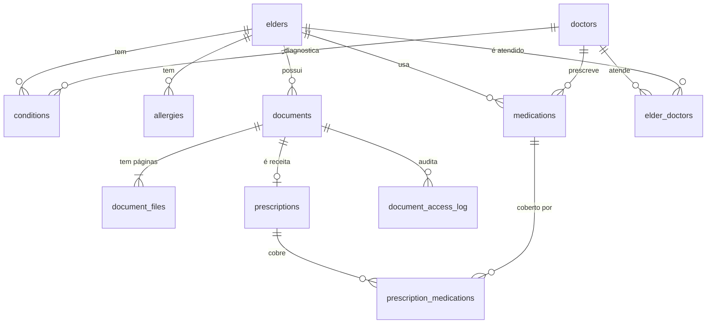

# Modelo de Dados: Saúde e Documentos

Segue as convenções de `specs/001-familia-e-acesso/data-model.md` (`family_id`, auditoria, soft delete, RLS).

## Tabelas

### `doctors`
`id`, `family_id`, `name` NOT NULL, `specialty`, `registration` (ex.: CRM, opcional), `phone`, `email`, `address`, `notes`, `status` (`active`, `archived`), campos de auditoria.

### `elder_doctors`
`elder_id`, `doctor_id`, `family_id`. PK composta (`elder_id`, `doctor_id`).

### `conditions`
`id`, `family_id`, `elder_id`, `name` NOT NULL, `icd_code` (CID, opcional), `diagnosed_on` (data aproximada, `date`), `doctor_id`, `status` (`active`, `controlled`, `resolved`), `notes`, auditoria, `deleted_at`.

### `allergies`
`id`, `family_id`, `elder_id`, `substance` NOT NULL, `reaction`, `severity` (`mild`, `moderate`, `severe`), `notes`, auditoria, `deleted_at`.

### `medications`
| Coluna | Tipo | Regra |
|---|---|---|
| id, family_id, elder_id | | |
| name | text NOT NULL | |
| dose | text | ex.: "50 mg" |
| form | enum | comprimido, cápsula, gotas, xarope, injeção, pomada, outro |
| prescriber_id | uuid FK `doctors` | opcional |
| starts_on | date NOT NULL | |
| ends_on | date | `>= starts_on` |
| continuous | boolean | uso contínuo |
| critical | boolean | dose crítica: escalonamento reforçado (feature 003) |
| stop_reason | text | preenchido ao encerrar |
| schedule | jsonb | posologia; estrutura definida na feature 003 |
| notes | text | |
| auditoria, deleted_at | | |

Visão `active_medications`: `starts_on <= current_date AND (ends_on IS NULL OR ends_on >= current_date) AND deleted_at IS NULL` (RN-SAU-06).

### `documents`
| Coluna | Tipo | Regra |
|---|---|---|
| id, family_id, elder_id | | |
| title | text NOT NULL | 1 a 120 caracteres |
| category | enum | `exam`, `report`, `prescription`, `certificate`, `health_plan`, `personal_id`, `other` |
| document_date | date | data do documento (ex.: do exame) |
| doctor_id | uuid FK | opcional |
| tags | text[] | etiquetas livres |
| content_hash | text | detecta duplicata |
| total_size_bytes | bigint | soma dos arquivos |
| auditoria, deleted_at | | |

Índice de busca: `tsvector` sobre `title` + `tags` (configuração `portuguese`, `unaccent`).

### `document_files`
`id`, `document_id`, `family_id`, `storage_path`, `mime_type`, `size_bytes` (máx. 20 MB), `page_order` smallint.

### `prescriptions`
`document_id` PK/FK (a receita é um documento categoria `prescription`), `family_id`, `kind` (`simple`, `controlled`, `antimicrobial`), `issued_on` NOT NULL, `valid_until` NOT NULL (`> issued_on`), `doctor_id`.

### `prescription_medications`
`prescription_id`, `medication_id`, `family_id`. PK composta.

### `document_access_log`
`id`, `family_id`, `document_id`, `user_id`, `action` (`view`, `download`, `share`), `created_at`. Somente inserção.

### Armazenamento
Bucket privado `documents`. Política: leitura e escrita somente se o primeiro segmento do caminho é uma `family_id` da qual o usuário é membro ativo (Leitor só lê).

## Diagrama

## RLS (resumo)

| Tabelas | SELECT | INSERT/UPDATE/DELETE (lógico) |
|---|---|---|
| doctors, elder_doctors, conditions, allergies, medications, documents, document_files, prescriptions, prescription_medications | membro ativo da família | Admin ou Membro, e só se o idoso estiver `active` (RN-SAU-16) |
| document_access_log | Admin | somente via `get_document_url` |

Teste pgTAP obrigatório: usuário da família B não lê nem escreve nenhuma linha da família A em nenhuma tabela acima nem no bucket.
