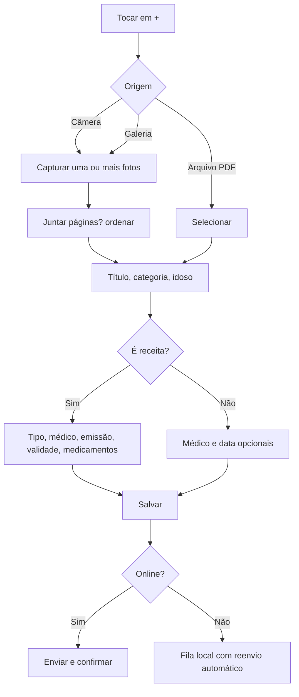
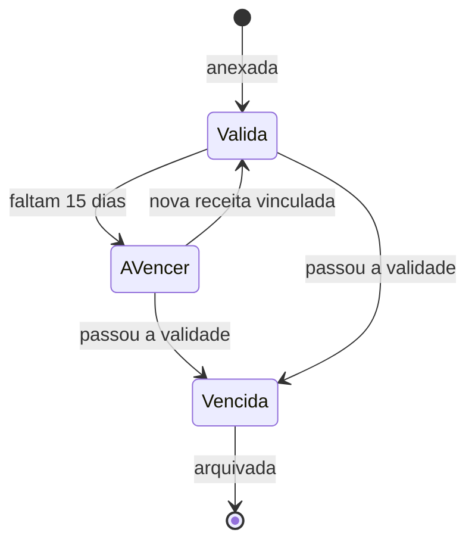
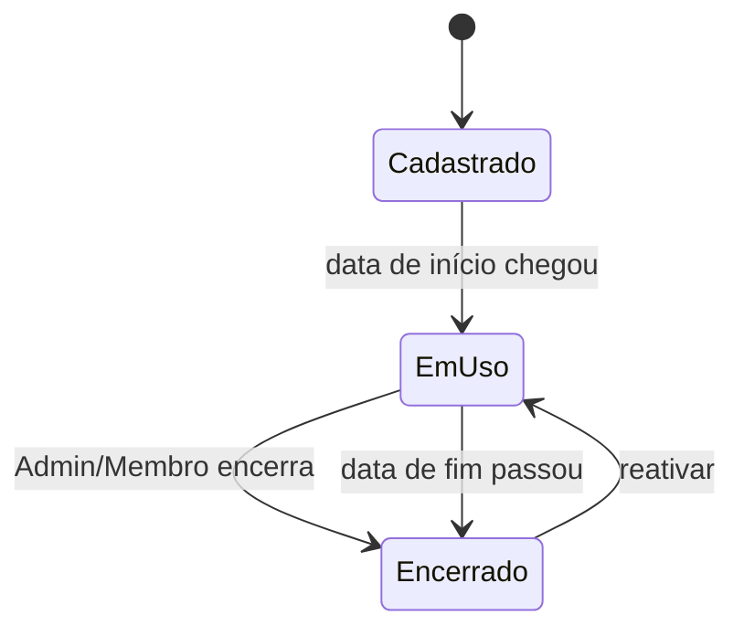

# Especificação: Saúde e Documentos

**Branch**: `002-saude-e-documentos` | **Criada**: 2026-11-13 | **Status**: Rascunho para revisão

**Entrada**: "Médicos, condições e diagnósticos, alergias, medicamentos em uso, receitas, exames e documentos, ficha de emergência." Depende da feature 001 (família, papéis, idosos).

> **Aviso de produto (constituição, princípio VI):** o EloSenior organiza informações. Não diagnostica, não recomenda doses e não substitui orientação médica. As telas clínicas trazem esse aviso de forma curta e visível.

## Cenários de Usuário e Testes *(obrigatório)*

### História 1 — Guardar e encontrar documentos de saúde (Prioridade: P1)

Um familiar fotografa ou anexa um exame, laudo ou receita, classifica e depois encontra rapidamente por busca ou filtro.

**Por que P1:** responde diretamente à dor "informações espalhadas em papel, WhatsApp e e-mail" e é o que mais gera valor imediato.

**Teste independente:** anexar três documentos de categorias diferentes a um idoso e localizar cada um por categoria, por texto e por data em menos de 30 segundos.

**Cenários de aceite:**

1. **Dado** que sou Membro ou Admin, **quando** tiro uma foto, escolho a galeria ou um PDF e informo título e categoria, **então** o documento é salvo no idoso escolhido e aparece na lista.
2. **Dado** que anexei fotos de várias páginas, **quando** escolho "juntar em um documento", **então** elas são guardadas como um único documento com as páginas em ordem.
3. **Dado** uma lista com vários documentos, **quando** busco por texto do título, por categoria, por médico ou por período, **então** a lista é filtrada imediatamente.
4. **Dado** um arquivo maior que 20 MB ou de formato não aceito, **quando** tento anexar, **então** o app informa o limite e os formatos aceitos (JPEG, PNG, HEIC, PDF).
5. **Dado** que sou Leitor, **quando** abro um documento, **então** posso ver e compartilhar, mas não editar nem excluir.
6. **Dado** um documento, **quando** o excluo, **então** ele vai para a lixeira por 30 dias e pode ser restaurado.

---

### História 2 — Cadastrar médicos (Prioridade: P1)

A família mantém uma lista de médicos e clínicas com contatos, usada em consultas, receitas e documentos.

**Por que P1:** consultas, receitas e documentos referenciam médicos; também é a lista de contatos que o cuidador mais consulta.

**Teste independente:** cadastrar dois médicos, vincular a dois idosos diferentes e ligar para um deles a partir do app.

**Cenários de aceite:**

1. **Dado** que sou Membro ou Admin, **quando** cadastro um médico com nome e especialidade, **então** ele fica disponível para toda a família.
2. **Dado** um médico com telefone, **quando** toco no número, **então** o app abre a discagem do aparelho.
3. **Dado** um médico vinculado a consultas ou receitas, **quando** tento excluí-lo, **então** o app informa os vínculos e oferece apenas arquivar o médico (some das listas de escolha, mas mantém o histórico).
4. **Dado** um médico que atende dois idosos, **quando** abro o perfil de cada idoso, **então** o médico aparece em ambos.

---

### História 3 — Registrar condições, alergias e medicamentos (Prioridade: P1)

O familiar registra o que o idoso tem (condições), a que é alérgico e o que toma (medicamentos com posologia).

**Por que P1:** é o núcleo do "histórico de saúde" e alimenta a agenda de medicamentos (feature 003) e a ficha de emergência.

**Teste independente:** cadastrar uma condição, uma alergia e um medicamento com posologia e vê-los na visão geral de saúde do idoso.

**Cenários de aceite:**

1. **Dado** que sou Membro ou Admin, **quando** registro uma condição com nome, data aproximada do diagnóstico, médico e status, **então** ela aparece no histórico do idoso.
2. **Dado** uma condição ativa, **quando** altero o status para "controlada" ou "resolvida", **então** o histórico guarda a mudança com data e autor, e ela sai da ficha de emergência se resolvida.
3. **Dado** que registro uma alergia com substância, reação e gravidade, **quando** salvo, **então** ela aparece com destaque na visão geral e na ficha de emergência.
4. **Dado** que registro um medicamento com nome, dose, forma e posologia, **quando** salvo, **então** ele passa a ser considerado "em uso" e fica disponível para a agenda de doses (feature 003).
5. **Dado** um medicamento em uso, **quando** o encerro informando a data e um motivo opcional, **então** ele vai para "histórico de medicamentos" e deixa de gerar doses futuras.
6. **Dado** um medicamento cujo nome coincide com uma alergia registrada, **quando** salvo, **então** o app mostra um aviso destacado para conferir com o médico, sem bloquear. *(Apenas comparação de nomes digitados; não é checagem clínica.)*

---

### História 4 — Guardar receitas e acompanhar a validade (Prioridade: P2)

A família guarda a foto da receita, informa a validade e é avisada antes de vencer.

**Por que P2:** muito útil (evita consulta de última hora), mas depende dos documentos e medicamentos já existirem.

**Teste independente:** anexar uma receita com validade em 10 dias, vincular um medicamento e receber o aviso de vencimento.

**Cenários de aceite:**

1. **Dado** que anexo uma receita, **quando** informo médico, data de emissão, validade e medicamentos, **então** ela é salva como documento da categoria "Receita" com esses vínculos.
2. **Dado** uma receita que vence em 15 dias, **quando** chega o dia do aviso, **então** os Admins e Membros recebem um lembrete "receita de [medicamento] vence em 15 dias".
3. **Dado** uma receita vencida, **quando** abro o medicamento vinculado, **então** vejo o aviso "sem receita válida" até que uma nova receita seja vinculada.
4. **Dado** um medicamento de uso contínuo sem nenhuma receita vinculada, **quando** abro a visão geral, **então** vejo uma sugestão discreta para anexar a receita (não bloqueia nada).
5. **Dado** que escolho o tipo da receita (simples, controle especial, antimicrobiano), **quando** informo a data de emissão, **então** o app sugere uma validade padrão editável.

---

### História 5 — Ficha de emergência (Prioridade: P2)

Uma tela única com os dados essenciais do idoso, pronta para mostrar ou enviar a um profissional.

**Por que P2:** dá tranquilidade (ganho do canvas) e reaproveita dados já cadastrados.

**Teste independente:** com dados cadastrados, abrir a ficha sem internet e gerar um PDF para compartilhar.

**Cenários de aceite:**

1. **Dado** um idoso com dados cadastrados, **quando** abro a ficha, **então** vejo nome, idade, tipo sanguíneo, alergias, condições ativas, medicamentos em uso, plano de saúde e contatos de emergência.
2. **Dado** que estou sem internet, **quando** abro a ficha de um idoso que já consultei, **então** ela abre com os dados da última sincronização e mostra a data dessa sincronização.
3. **Dado** a ficha aberta, **quando** toco em "Compartilhar", **então** o app gera um PDF no momento e abre o menu de compartilhamento do aparelho.
4. **Dado** um contato de emergência, **quando** toco no telefone, **então** o app abre a discagem.

---

### História 6 — Visão geral de saúde por idoso (Prioridade: P3)

Uma tela que resume o estado atual: alergias, condições ativas, medicamentos em uso, próximas consultas e últimos documentos.

**Por que P3:** é uma tela de conveniência sobre dados já existentes.

**Teste independente:** abrir a visão geral de um idoso com dados completos e navegar por cada bloco até o detalhe.

**Cenários de aceite:**

1. **Dado** um idoso com dados, **quando** abro a visão geral, **então** vejo os blocos de alergias, condições ativas, medicamentos em uso, receitas a vencer e últimos documentos, cada um levando ao detalhe.
2. **Dado** um idoso sem dados, **quando** abro a visão geral, **então** vejo sugestões de primeiros passos (ex.: "Registre as alergias").

---

### Casos de Borda

- Foto desfocada ou escura: o app não valida a qualidade, mas permite substituir o arquivo depois.
- Upload interrompido por perda de conexão: o arquivo fica na fila do aparelho e é reenviado automaticamente; o item mostra "enviando".
- Mesmo arquivo enviado duas vezes (mesmo conteúdo): o app avisa sobre possível duplicata.
- Medicamento com nome livre e grafia diferente da alergia (ex.: "dipirona" e "Novalgina"): sem detecção. Aviso só por nome digitado igual (ignora acentos e maiúsculas).
- Idoso arquivado: tudo fica somente leitura, incluindo documentos.
- Documento anexado a um médico arquivado: continua exibindo o nome do médico.
- Família atinge 1 GB de armazenamento: novos uploads são bloqueados com mensagem, e o Admin vê o uso por idoso.
- Data de validade anterior à data de emissão da receita: o app impede salvar.
- Edição simultânea do mesmo registro por dois membros: vence a última gravação, com o conflito registrado no histórico e o primeiro autor notificado.

## Requisitos *(obrigatório)*

### Requisitos Funcionais

- **FR-001**: O sistema DEVE permitir anexar documentos (JPEG, PNG, HEIC, PDF, até 20 MB) por câmera, galeria ou seletor de arquivos.
- **FR-002**: O sistema DEVE permitir juntar várias fotos em um único documento.
- **FR-003**: O sistema DEVE classificar documentos por categoria: Exame, Laudo, Receita, Atestado, Plano de saúde, Documento pessoal, Outro.
- **FR-004**: O sistema DEVE permitir buscar e filtrar documentos por texto, categoria, médico e período.
- **FR-005**: O sistema DEVE permitir cadastrar médicos com nome, especialidade, telefone, e-mail, endereço e observações, e arquivá-los.
- **FR-006**: O sistema DEVE permitir vincular médicos a idosos.
- **FR-007**: O sistema DEVE permitir registrar condições com nome, CID opcional, data de diagnóstico, médico, status e observações.
- **FR-008**: O sistema DEVE permitir registrar alergias com substância, reação e gravidade.
- **FR-009**: O sistema DEVE permitir registrar medicamentos com nome, dose, forma, posologia, médico prescritor, data de início e de fim, e indicação de uso contínuo.
- **FR-010**: O sistema DEVE manter histórico de medicamentos encerrados.
- **FR-011**: O sistema DEVE permitir registrar receitas com tipo, médico, data de emissão, validade e medicamentos vinculados.
- **FR-012**: O sistema DEVE avisar sobre receitas a vencer (15 e 3 dias antes) e vencidas.
- **FR-013**: O sistema DEVE mostrar aviso, sem bloqueio, quando o nome de um medicamento coincidir com uma alergia registrada.
- **FR-014**: O sistema DEVE oferecer ficha de emergência por idoso, disponível offline após o primeiro acesso, e exportável em PDF.
- **FR-015**: O sistema DEVE mover itens excluídos para a lixeira por 30 dias, com restauração.
- **FR-016**: O sistema DEVE registrar no feed toda criação, alteração e exclusão de registros de saúde e documentos, e na trilha de auditoria todo acesso a documentos.
- **FR-017**: O sistema DEVE guardar arquivos em armazenamento privado, acessíveis só por link temporário (validade de até 1 hora) para membros da família.
- **FR-018**: O sistema DEVE limitar o armazenamento a 1 GB por família e mostrar o uso ao Admin.
- **FR-019**: O sistema DEVE exibir o aviso de que o app não substitui orientação médica nas telas clínicas.

### Regras de Negócio

| ID | Regra |
|---|---|
| RN-SAU-01 | Médicos, condições, alergias, medicamentos, receitas e documentos pertencem à família e a um idoso (médicos são da família e vinculáveis a vários idosos). |
| RN-SAU-02 | Admin e Membro criam, editam e excluem. Leitor só visualiza, baixa e compartilha. |
| RN-SAU-03 | Excluir vai para a lixeira por 30 dias. Médico com vínculos só pode ser arquivado, nunca excluído. |
| RN-SAU-04 | Condição tem status: ativa, controlada ou resolvida. Só as ativas e controladas aparecem na ficha de emergência. |
| RN-SAU-05 | Alergia tem gravidade: leve, moderada ou grave. Alergias graves aparecem em destaque. |
| RN-SAU-06 | Medicamento está "em uso" se a data de início já passou e não há data de fim anterior a hoje. A posologia é detalhada na feature 003. |
| RN-SAU-07 | Medicamento só gera lembretes enquanto estiver em uso. Encerrar o medicamento cancela doses futuras. |
| RN-SAU-08 | Receita exige data de emissão e validade posterior à emissão. Validade sugerida por tipo (simples: 180 dias; controle especial: 30 dias; antimicrobiano: 10 dias) é apenas valor de partida editável. **Os prazos devem ser confirmados com assessoria regulatória antes do lançamento.** |
| RN-SAU-09 | Avisos de receita: 15 dias e 3 dias antes de vencer, e no dia seguinte ao vencimento. Vão para Admin e Membro. |
| RN-SAU-10 | Medicamento de uso contínuo sem receita válida gera aviso passivo na visão geral, nunca bloqueio. |
| RN-SAU-11 | Aviso de alergia compara o nome do medicamento com as substâncias registradas, ignorando acento e caixa. É apenas um lembrete para conferir com o médico. |
| RN-SAU-12 | Documento: até 20 MB, formatos JPEG, PNG, HEIC e PDF. Limite de 1 GB por família. Fotos HEIC são convertidas para JPEG no envio quando necessário. |
| RN-SAU-13 | A ficha de emergência só mostra campos preenchidos e a data da última sincronização. O PDF é gerado sob demanda e não fica armazenado. Compartilhamento por link público está fora do MVP. |
| RN-SAU-14 | Todo acesso a um documento (abrir, baixar, compartilhar) é registrado na trilha de auditoria (autor, data, documento). |
| RN-SAU-15 | O app não faz recomendações clínicas, não calcula doses e não verifica interações medicamentosas. |
| RN-SAU-16 | Idosos arquivados tornam todos os registros de saúde somente leitura. |

### Entidades-Chave

- **Médico:** nome, especialidade, registro profissional (opcional), contatos, endereço, observações, situação (ativo/arquivado).
- **Vínculo Médico–Idoso:** liga médico a idoso.
- **Condição:** idoso, nome, CID, data de diagnóstico, médico, status, observações.
- **Alergia:** idoso, substância, reação, gravidade.
- **Medicamento:** idoso, nome, dose, forma, posologia (ver feature 003), prescritor, início, fim, uso contínuo, motivo de encerramento.
- **Documento:** idoso, título, categoria, data do documento, médico, páginas/arquivos, tamanho, etiquetas.
- **Receita:** documento com tipo, emissão, validade e vínculos a medicamentos.
- **Acesso a documento (auditoria):** quem, quando, qual.

## Fluxos

### Adicionar documento

### Ciclo da receita

### Ciclo do medicamento

## Critérios de Sucesso *(obrigatório)*

- **SC-001**: Um usuário localiza um documento específico em menos de 30 segundos em 90% dos testes de usabilidade.
- **SC-002**: Anexar um documento por foto leva no máximo 3 toques depois da tela do idoso, e menos de 1 minuto no total.
- **SC-003**: 80% das receitas cadastradas têm validade informada.
- **SC-004**: A ficha de emergência abre em menos de 2 segundos, inclusive offline.
- **SC-005**: Nenhum documento é acessível sem sessão válida de membro da família (teste de isolamento automatizado e teste de link expirado).

## Decisões assumidas e pontos em aberto

1. **Validades padrão de receita** (RN-SAU-08) são valores de partida; confirmar com assessoria regulatória.
2. **Aviso de alergia** é por nome digitado igual. Confirmar se entra no MVP ou se vira feature posterior com base de medicamentos.
3. **Ficha de emergência** sem link público no MVP (risco de privacidade). Alternativa futura: link temporário com PIN.
4. **Etiquetas livres** em documentos ficam no MVP como campo simples, sem gerenciamento de vocabulário.
5. **OCR e leitura automática de receitas** ficam fora do MVP.
6. **Limite de 1 GB** por família é provisório; ajustar após medir o uso real.

## Premissas

- Os usuários fotografam documentos pelo próprio app ou os recebem por WhatsApp/e-mail e anexam pela galeria ou pelo seletor de arquivos.
- Conversão HEIC e geração de PDF ocorrem no aparelho ou em função de borda, sem custo relevante no MVP.
- Esta feature não cria lembretes de doses: ela define o medicamento; a agenda de doses vem na feature 003.
