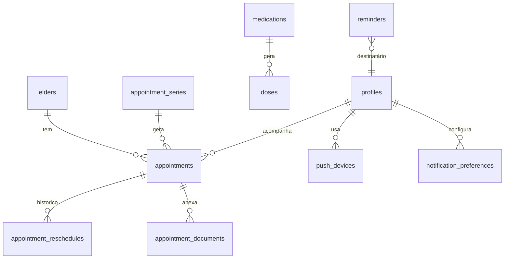

# Modelo de Dados: Agenda e Lembretes

Segue as convenções de `specs/001-familia-e-acesso/data-model.md`. Usa `elders`, `doctors`, `medications` e `documents` das features anteriores.

## Tabelas

### `appointments`
| Coluna | Tipo | Regra |
|---|---|---|
| id, family_id, elder_id | | |
| type | enum | `consultation`, `exam`, `procedure`, `other` |
| title | text NOT NULL | |
| starts_at | timestamptz NOT NULL | |
| duration_min | integer | opcional; conflito assume 60 (RN-AGE-14) |
| location | text | endereço livre |
| doctor_id | uuid FK `doctors` | opcional |
| preparation | text | ex.: "jejum de 8 h" |
| companion_id | uuid FK `profiles` | acompanhante; opcional |
| status | enum | `scheduled`, `done`, `cancelled`, `no_show` |
| post_notes | text | anotações após realizar |
| series_id | uuid FK | opcional |
| series_exception | boolean | ocorrência editada isoladamente |
| auditoria, deleted_at | | |

### `appointment_reschedules`
`id`, `appointment_id`, `family_id`, `previous_starts_at`, `new_starts_at`, `changed_by`, `changed_at`.

### `appointment_documents`
`appointment_id`, `document_id`, `family_id`. Liga documentos de 002 a compromissos.

### `appointment_series`
`id`, `family_id`, `elder_id`, `rrule` (texto), `until` (date) ou `count` (≤ 52, RN-AGE-15), `template` (jsonb com os campos do compromisso), auditoria.

### Posologia (em `medications.schedule`, jsonb)
Estrutura validada por `CHECK` e por Zod no app:

```json
{
  "mode": "fixed_times | interval | as_needed",
  "times": ["08:00", "20:00"],
  "interval_hours": 8,
  "first_dose_time": "06:00",
  "weekdays": [1, 2, 3, 4, 5, 6, 7]
}
```

Campos extras em `medications` (a serem adicionados à tabela da feature 002):
`responsible_id` (uuid FK `profiles`, opcional), `stock_quantity` (numeric), `stock_updated_at` (timestamptz), `dose_quantity` (numeric, unidades por dose para estimar consumo).

### `doses`
| Coluna | Tipo | Regra |
|---|---|---|
| id, family_id, elder_id | | |
| medication_id | uuid FK | |
| scheduled_at | timestamptz NOT NULL | gerado a partir do horário de parede (RN-AGE-06) |
| status | enum | `pending`, `taken`, `skipped`, `missed` |
| resolved_by | uuid FK | quem confirmou/pulou |
| resolved_at | timestamptz | quando o registro foi feito |
| taken_at | timestamptz | hora real da tomada (pode diferir de `resolved_at` em registro tardio) |
| skip_reason | text | |
| is_prn | boolean | dose avulsa "se necessário" (sem agenda) |

Restrição de unicidade: (`medication_id`, `scheduled_at`) para doses programadas. `UPDATE` só passa se `status = 'pending'` ou (`status = 'missed'` e `now() - scheduled_at <= 24 h`).

### `reminders`
| Coluna | Tipo | Regra |
|---|---|---|
| id, family_id | | |
| dedupe_key | text UNIQUE | ex.: `dose:<id>:t30`, `appt:<id>:eve`, `rx:<id>:15d` |
| kind | enum | `appointment`, `dose`, `dose_escalation`, `dose_critical`, `prescription`, `stock`, `task` |
| ref_table, ref_id | | objeto relacionado |
| recipient_id | uuid FK `profiles` | |
| fire_at | timestamptz | |
| channel | enum | `push`, `email` |
| status | enum | `scheduled`, `sent`, `delivered`, `failed`, `cancelled` |
| attempts | smallint | |
| error | text | motivo da falha |
| sent_at, receipt_checked_at | timestamptz | |

Índice parcial em (`fire_at`) onde `status = 'scheduled'`, usado pelo motor.

### `push_devices`
`id`, `user_id`, `platform` (`ios`, `android`), `expo_token`, `status` (`active`, `invalid`), `last_seen_at`, `notifications_enabled` (informado pelo app).

### `notification_preferences`
`user_id`, `family_id`, `elder_id` (nulo = todos), `category` (`appointment`, `dose`, `dose_escalation`, `prescription`, `stock`, `task`, `activity`), `enabled`, `appointment_offsets` (array de minutos), `hide_details_on_lock_screen` (boolean).

## Diagrama



## RLS (resumo)

| Tabela | SELECT | Escrita |
|---|---|---|
| appointments, appointment_*, doses | membro ativo | Admin/Membro (idoso ativo). Doses só via funções RPC |
| reminders | o destinatário e Admin | somente motor (service role) |
| push_devices, notification_preferences | o próprio usuário | o próprio usuário |

Teste pgTAP: confirmação concorrente da mesma dose por dois usuários resulta em exatamente uma confirmação.
