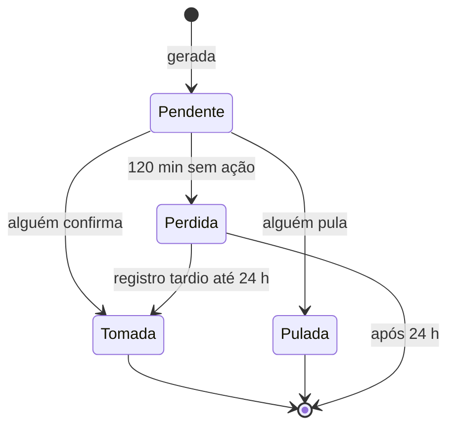
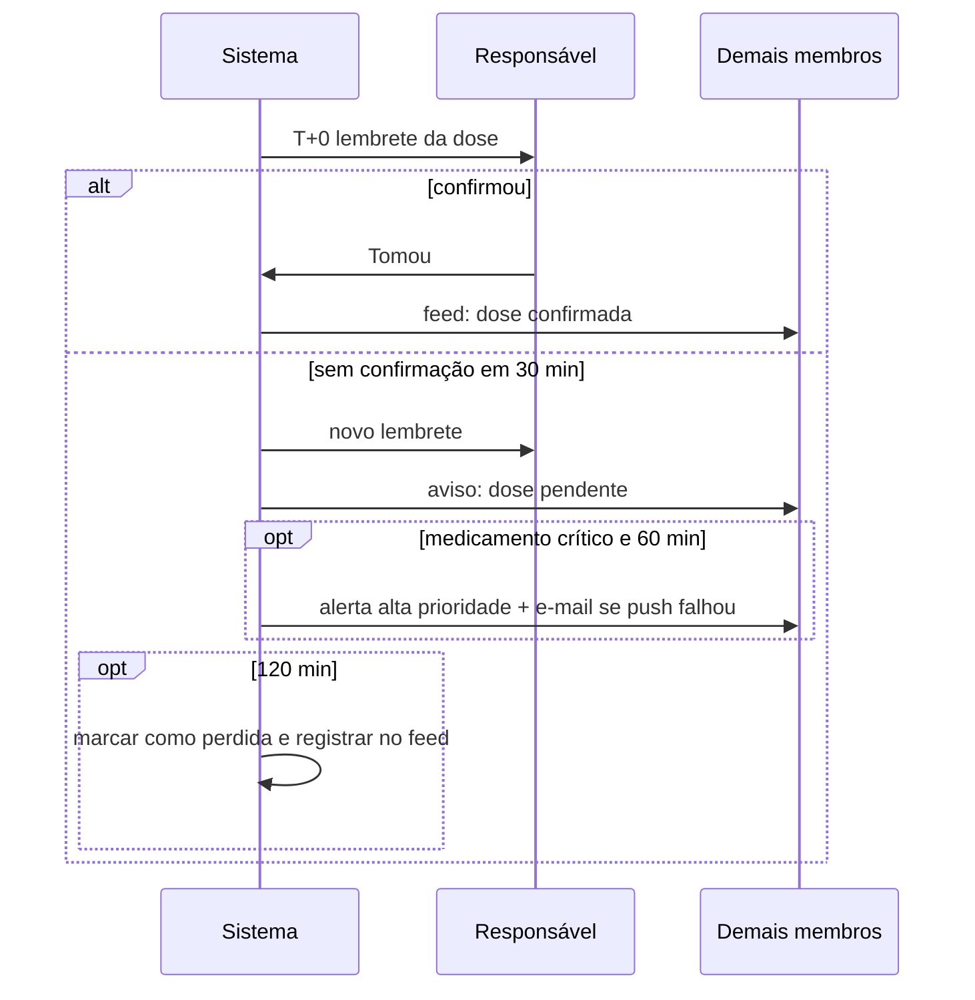
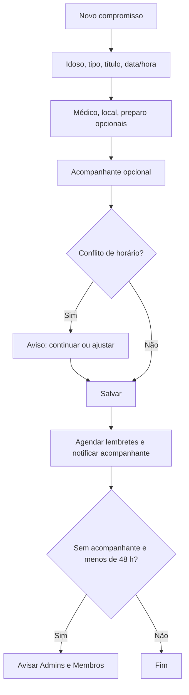

# Especificação: Agenda e Lembretes

**Branch**: `003-agenda-e-lembretes` | **Criada**: 2026-11-13 | **Status**: Rascunho para revisão

**Entrada**: "Consultas e exames, horários de medicamentos, lembretes por push, confirmação de realizado/tomado, responsável por acompanhar, conflitos e recorrência." Depende de 001 (família, idosos) e 002 (médicos, medicamentos).

## Cenários de Usuário e Testes *(obrigatório)*

### História 1 — Agendar consulta ou exame e ser lembrado (Prioridade: P1)

Um familiar registra uma consulta ou exame com data, local, médico e preparo, escolhe quem acompanha, e os envolvidos recebem lembretes.

**Por que P1:** responde à dor "esquecimento de consultas e exames" e à divisão de responsabilidades.

**Teste independente:** criar uma consulta para amanhã com acompanhante; o acompanhante recebe os lembretes; após a consulta, marcar como realizada com uma anotação.

**Cenários de aceite:**

1. **Dado** que sou Membro ou Admin, **quando** crio um compromisso com idoso, tipo, título, data e hora, **então** ele aparece na agenda de todos os membros.
2. **Dado** um compromisso com médico, local e instruções de preparo (ex.: "jejum de 8 h"), **quando** abro o detalhe, **então** vejo tudo, com botões para ligar ao médico e abrir o endereço no mapa.
3. **Dado** um compromisso criado, **quando** escolho um acompanhante, **então** ele é notificado da atribuição e o compromisso aparece destacado na agenda dele.
4. **Dado** um compromisso amanhã às 14h, **quando** chega o horário dos lembretes padrão (véspera às 18h e 2 h antes), **então** o acompanhante e os membros que querem lembretes recebem a notificação.
5. **Dado** um compromisso sem acompanhante a menos de 48 horas, **quando** o prazo chega, **então** os Admins e Membros são avisados "Consulta de [Maria] sem acompanhante".
6. **Dado** um compromisso passado, **quando** o marco como "realizado", **então** posso anotar o que foi dito e anexar documentos (ex.: receita, laudo) que ficam ligados ao compromisso.
7. **Dado** um compromisso, **quando** o remarco, **então** a data muda, o histórico guarda a data anterior, os lembretes são recalculados e os envolvidos são notificados.
8. **Dado** que sou Leitor, **quando** vejo a agenda, **então** posso ver tudo, mas não criar nem alterar.

---

### História 2 — Lembretes de medicamentos com confirmação de dose (Prioridade: P1)

Cada medicamento em uso tem horários. No horário, o app lembra e alguém confirma que a dose foi tomada. Se ninguém confirma, o aviso escala para os outros.

**Por que P1:** é o ponto de maior risco para a saúde e de maior valor percebido (princípio V da constituição).

**Teste independente:** configurar um medicamento com dois horários; no horário, confirmar a dose; em outro horário, não confirmar e verificar o escalonamento.

**Cenários de aceite:**

1. **Dado** um medicamento em uso, **quando** defino a posologia (horários fixos, a cada X horas, dias da semana ou "se necessário"), **então** o app gera as doses dos próximos 14 dias e as renova diariamente.
2. **Dado** uma dose no horário, **quando** o responsável do medicamento recebe a notificação e toca em "Tomou", **então** a dose é registrada como tomada com autor e hora, e o feed mostra.
3. **Dado** uma dose pendente, **quando** passam 30 minutos sem confirmação, **então** o responsável é lembrado de novo e os demais Admins e Membros recebem "Dose de [medicamento] de [Maria] ainda não confirmada".
4. **Dado** um medicamento marcado como crítico e uma dose pendente por 60 minutos, **quando** o prazo chega, **então** todos os Admins e Membros recebem alerta de alta prioridade, e quem tem push indisponível recebe e-mail.
5. **Dado** uma dose pendente por 2 horas, **quando** o prazo chega, **então** ela passa para "perdida", é registrada no feed e no histórico de adesão. Ainda posso registrá-la como tomada com horário real em até 24 horas.
6. **Dado** uma dose, **quando** toco em "Pulou" e informo um motivo opcional, **então** a dose fica "pulada" e não escala.
7. **Dado** que dois membros tocam em "Tomou" quase ao mesmo tempo, **quando** o segundo confirma, **então** o app informa que já foi confirmada por [nome] às [hora] e não duplica.
8. **Dado** o horário de uma dose chegando e meu aparelho sem internet, **quando** a hora chega, **então** a notificação local agendada aparece mesmo assim.
9. **Dado** que as notificações do app estão desativadas no aparelho, **quando** abro o app, **então** vejo um aviso persistente no topo explicando o risco e como reativar.
10. **Dado** um medicamento "se necessário", **quando** o registro como administrado, **então** a dose avulsa é registrada sem lembretes.

---

### História 3 — Ver o que há "hoje" e a agenda do mês (Prioridade: P1)

A tela inicial mostra o que precisa ser feito hoje por idoso (doses, consultas, tarefas), e há um calendário para ver a semana e o mês.

**Por que P1:** é a tela mais usada do app e concentra o valor de "organização e praticidade".

**Teste independente:** com compromissos e doses cadastrados, abrir a tela "Hoje" e conferir ordem, status e que doses podem ser confirmadas com um toque.

**Cenários de aceite:**

1. **Dado** doses e compromissos de hoje, **quando** abro "Hoje", **então** vejo uma lista cronológica por idoso, com pendentes em destaque e atrasados no topo.
2. **Dado** uma dose na lista, **quando** toco em "Tomou", **então** ela é confirmada sem abrir outra tela (1 toque).
3. **Dado** vários idosos, **quando** uso o filtro, **então** vejo só os de um idoso.
4. **Dado** o calendário, **quando** alterno entre dia, semana e mês, **então** vejo os compromissos e um marcador de dias com doses perdidas.
5. **Dado** que estou sem internet, **quando** abro "Hoje", **então** vejo os dados da última sincronização com aviso de modo offline.

---

### História 4 — Detectar conflitos e sobrecarga na agenda (Prioridade: P2)

O app avisa quando dois compromissos se sobrepõem para o mesmo idoso ou para o mesmo acompanhante.

**Por que P2:** evita erros, mas não impede o uso básico.

**Teste independente:** criar dois compromissos sobrepostos e ver o aviso de conflito.

**Cenários de aceite:**

1. **Dado** um compromisso existente, **quando** crio outro do mesmo idoso com horários sobrepostos, **então** o app avisa e permite continuar.
2. **Dado** que atribuo a um acompanhante dois compromissos sobrepostos de idosos diferentes, **quando** salvo, **então** o app avisa "[nome] já acompanha outro compromisso nesse horário".
3. **Dado** que fiz a mesma atribuição de acompanhante em muitos compromissos do mês, **quando** abro a agenda, **então** posso ver quantos compromissos cada membro acompanha (ver feature 005 para a visão de distribuição).

---

### História 5 — Compromissos recorrentes (Prioridade: P2)

Sessões de fisioterapia, hemodiálise ou hidroginástica se repetem. O usuário cria uma série.

**Por que P2:** muito comum entre idosos, mas o MVP funciona com compromissos únicos.

**Teste independente:** criar uma série semanal por 8 semanas, alterar uma ocorrência e cancelar a série.

**Cenários de aceite:**

1. **Dado** que crio um compromisso, **quando** escolho repetir (semanal, a cada 2 semanas, mensal) e um fim (data ou número de ocorrências), **então** as ocorrências aparecem na agenda.
2. **Dado** uma série, **quando** edito uma só ocorrência, **então** só ela muda.
3. **Dado** uma série, **quando** escolho "esta e as próximas", **então** a série é dividida a partir daquela ocorrência.
4. **Dado** uma série, **quando** a cancelo, **então** as ocorrências futuras somem e as passadas permanecem no histórico.

---

### História 6 — Histórico de adesão e estoque de medicamentos (Prioridade: P3)

O familiar vê quantas doses foram tomadas, puladas e perdidas por período, e é avisado quando o remédio está acabando.

**Por que P3:** informação útil para levar ao médico, mas secundária à confirmação das doses.

**Teste independente:** acompanhar uma semana de doses e ver o resumo; informar o estoque e receber o aviso.

**Cenários de aceite:**

1. **Dado** doses registradas, **quando** abro o histórico de um medicamento, **então** vejo a adesão (tomadas, puladas, perdidas) por semana e por mês.
2. **Dado** que informo a quantidade em estoque, **quando** o estoque estimado chega a 5 dias de uso, **então** Admins e Membros recebem o aviso "Losartana acaba em cerca de 5 dias".
3. **Dado** o histórico, **quando** toco em "Compartilhar", **então** o app gera um resumo em PDF para levar à consulta.

---

### Casos de Borda

- Mudança de fuso do aparelho ou viagem: horários dos medicamentos seguem o fuso da família (horário de parede), não o do aparelho.
- Horário de verão ou mudança de relógio: horários fixos mantêm a hora local; intervalos em horas mantêm a duração.
- Notificação entregue com o aparelho em "Não perturbe": o app mostra o aviso persistente de configuração, e dose crítica usa canal de alta prioridade (quando permitido pelo sistema).
- Medicamento alterado ou encerrado: doses futuras pendentes são recalculadas ou canceladas; as passadas permanecem.
- Usuário removido da família: lembretes e atribuições dele são redistribuídos e o Admin é avisado.
- Responsável do medicamento deixa de existir: o lembrete vai a todos os Admins e Membros com lembretes ligados.
- Primeiro horário no passado ao criar o medicamento: a primeira dose é a próxima futura. Passadas não são geradas.
- Muitos medicamentos num mesmo horário: os lembretes são agrupados em uma única notificação por idoso e horário.
- Limite de 64 notificações locais no iOS: o app agenda localmente as próximas 60 mais próximas e repõe a cada abertura e em segundo plano.
- Compromisso criado com data no passado: permitido (registro retroativo) e entra direto como "realizado" ou "pendente de registro".

## Requisitos *(obrigatório)*

### Requisitos Funcionais

- **FR-001**: O sistema DEVE permitir criar, editar, remarcar, cancelar e marcar como realizado compromissos de idosos, com tipo (consulta, exame, procedimento, outro), título, data/hora, duração opcional, local, médico, preparo e anotações.
- **FR-002**: O sistema DEVE permitir atribuir um acompanhante (membro) a cada compromisso.
- **FR-003**: O sistema DEVE permitir anexar documentos e anotações a um compromisso.
- **FR-004**: O sistema DEVE manter histórico de remarcações.
- **FR-005**: O sistema DEVE permitir definir a posologia do medicamento: horários fixos diários, intervalo em horas, dias da semana, ou "se necessário".
- **FR-006**: O sistema DEVE gerar doses e renová-las automaticamente com horizonte de 14 dias.
- **FR-007**: O sistema DEVE permitir confirmar, pular ou registrar dose avulsa, com autor e horário.
- **FR-008**: O sistema DEVE enviar lembretes por push e agendar notificações locais no aparelho.
- **FR-009**: O sistema DEVE escalonar doses não confirmadas conforme RN-AGE-07 a RN-AGE-09.
- **FR-010**: O sistema DEVE detectar e exibir de forma persistente quando as notificações estiverem desativadas ou sem token de push válido.
- **FR-011**: O sistema DEVE enviar e-mail como canal alternativo para alertas críticos quando o push falhar.
- **FR-012**: O sistema DEVE registrar o resultado de cada lembrete (agendado, enviado, entregue, falhou) e de cada dose (pendente, tomada, pulada, perdida).
- **FR-013**: O sistema DEVE oferecer tela "Hoje" por idoso e calendário (dia, semana, mês).
- **FR-014**: O sistema DEVE avisar sobre conflitos de horário (mesmo idoso e mesmo acompanhante).
- **FR-015**: O sistema DEVE permitir compromissos recorrentes (semanal, quinzenal, mensal) com edição de uma ocorrência ou de "esta e as próximas".
- **FR-016**: O sistema DEVE permitir que cada usuário escolha quais lembretes recebe, por categoria e por idoso.
- **FR-017**: O sistema DEVE mostrar histórico de adesão por medicamento e período.
- **FR-018**: O sistema DEVE permitir informar estoque de medicamento e avisar quando estiver acabando.
- **FR-019**: O sistema DEVE funcionar offline para leitura de "Hoje" e para exibir lembretes já agendados localmente; confirmações feitas offline sincronizam ao reconectar.
- **FR-020**: O sistema DEVE registrar no feed compromissos criados, remarcados, cancelados e realizados, e doses confirmadas, puladas ou perdidas.

### Regras de Negócio

| ID | Regra |
|---|---|
| RN-AGE-01 | Admin e Membro criam e alteram compromissos e confirmam doses. Leitor só visualiza e não confirma doses. |
| RN-AGE-02 | Compromisso tem status: agendado, realizado, cancelado, não compareceu. Remarcar mantém o status "agendado" e grava a data anterior no histórico. |
| RN-AGE-03 | Lembretes padrão de compromisso: véspera às 18h e 2 horas antes. Cada usuário pode desligar ou ajustar entre as opções: 1 dia, 2 horas, 30 minutos. |
| RN-AGE-04 | Compromisso sem acompanhante a menos de 48 h gera aviso a Admins e Membros (uma vez). |
| RN-AGE-05 | Posologia: horários fixos (HH:MM), intervalo em horas (1 a 72), dias da semana, ou "se necessário" (sem doses programadas). Início na data de início do medicamento; fim na data de fim, se houver. |
| RN-AGE-06 | Horários de dose seguem o fuso da família (horário de parede). Doses são geradas para os próximos 14 dias e renovadas por rotina diária. Alterar a posologia recalcula apenas as doses futuras pendentes. |
| RN-AGE-07 | Dose pendente: lembrete no horário (ao responsável do medicamento, ou a todos os Admins/Membros se não houver responsável). Aos 30 min sem confirmação: novo lembrete ao responsável e aviso a todos os Admins e Membros com a opção ligada (padrão: ligada). |
| RN-AGE-08 | Medicamento crítico: aos 60 min sem confirmação, alerta de alta prioridade a todos os Admins e Membros e e-mail aos que não tiverem push funcionando. |
| RN-AGE-09 | Aos 120 min sem confirmação a dose vira "perdida". Registro tardio como "tomada" é permitido em até 24 h, informando o horário real. Depois disso a dose fica imutável. |
| RN-AGE-10 | A primeira confirmação vence. Confirmações concorrentes não duplicam; a segunda vê quem confirmou. |
| RN-AGE-11 | Pular dose não escala e conta como "pulada" no histórico. Só Admin e Membro pulam. |
| RN-AGE-12 | Notificações de dose do mesmo idoso e horário são agrupadas em uma só. |
| RN-AGE-13 | Falha de entrega nunca é silenciosa: sem permissão de notificação ou sem token válido, o app exibe aviso persistente e, para alerta crítico, o e-mail é enviado. Cada lembrete tem seu resultado registrado. |
| RN-AGE-14 | Conflito: dois compromissos do mesmo idoso com intervalo sobreposto, ou do mesmo acompanhante com sobreposição, geram aviso, não bloqueio. Compromisso sem duração considera 1 hora. |
| RN-AGE-15 | Recorrência: semanal, quinzenal ou mensal, com fim por data ou número de ocorrências (máximo 52). |
| RN-AGE-16 | Estoque: o usuário informa quantidade; o consumo é estimado a partir das doses tomadas. Aviso quando restam 5 dias estimados. |
| RN-AGE-17 | Idoso arquivado: doses futuras e lembretes são cancelados; histórico permanece. |
| RN-AGE-18 | Membro removido: acompanhamentos e responsabilidade de medicamentos passam a "sem responsável" e o Admin é avisado. |
| RN-AGE-19 | O app não sugere, altera nem recomenda horários ou doses. Apenas registra o que a família informou. |

### Entidades-Chave

- **Compromisso:** idoso, tipo, título, início, duração, local, médico, preparo, acompanhante, status, anotações pós-compromisso, série (opcional), histórico de remarcações.
- **Série de recorrência:** regra, fim, compromissos gerados.
- **Posologia:** regra de horários ligada ao medicamento (feature 002).
- **Dose:** medicamento, data/hora prevista, status (pendente, tomada, pulada, perdida), quem confirmou, hora real.
- **Lembrete:** objeto relacionado, destinatário, momento, canal, resultado.
- **Preferências de notificação:** por usuário, categoria e idoso.
- **Dispositivo/Token de push:** usuário, plataforma, token, situação.

## Fluxos

### Ciclo de uma dose e escalonamento

### Criar compromisso

## Critérios de Sucesso *(obrigatório)*

- **SC-001**: 80% das doses são confirmadas em até 30 minutos do horário (métrica M5 da visão do produto).
- **SC-002**: Confirmar uma dose leva 1 toque a partir da notificação ou da tela "Hoje".
- **SC-003**: 99% dos lembretes de dose são entregues ou têm falha registrada e comunicada em até 5 minutos do horário previsto.
- **SC-004**: Zero doses sem registro de resultado após 24 horas.
- **SC-005**: Menos de 5% dos usuários com notificações desativadas permanecem nesse estado após 7 dias do aviso.
- **SC-006**: Criar um compromisso com acompanhante leva menos de 90 segundos.

## Decisões assumidas e pontos em aberto

1. **Tempos de escalonamento** (30, 60 e 120 min) são hipóteses. Medir em campo e permitir ajuste por família numa versão posterior.
2. **Aviso aos demais membros aos 30 min** está ligado por padrão (pode incomodar). Confirmar o padrão com usuários.
3. **Responsável do medicamento:** cada medicamento tem um responsável opcional. Alternativa: sempre notificar todos. Confirmar.
4. **E-mail como canal alternativo** só para medicamentos críticos. SMS e ligação ficam fora do MVP.
5. **Registro tardio de dose** em até 24 h; confirmar se é suficiente.
6. **Quem marca "crítico"** o medicamento: qualquer Admin ou Membro. Sem validação clínica. Confirmar se vale texto de apoio.
7. **Janela de 14 dias** para geração de doses é técnica e pode mudar sem afetar o usuário.

## Premissas

- Os usuários concedem permissão de notificação; sem ela, o produto perde o principal valor e o app insiste com o aviso persistente.
- O provedor de push (Expo/FCM/APNs) tem entrega probabilística, daí a necessidade de notificação local e de e-mail para casos críticos.
- O dado de fuso da família (feature 001) está correto.
