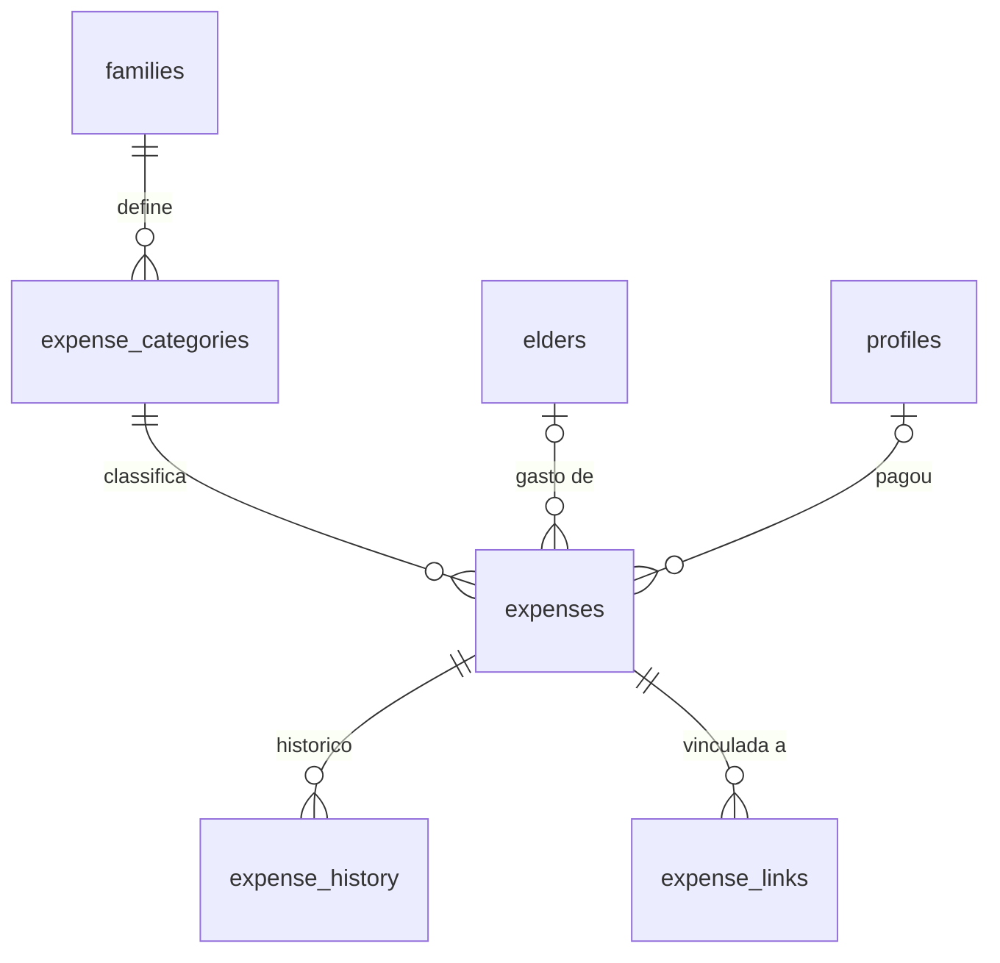

# Modelo de Dados: Registro de Despesas

Segue as convenções de `specs/001-familia-e-acesso/data-model.md`.

## Tabelas

### `expense_categories`
| Coluna | Tipo | Regra |
|---|---|---|
| id, family_id | | |
| name | text NOT NULL | único por família entre ativas |
| kind | enum `default`, `custom` | padrão semeadas ao criar a família (RN-DES-09) |
| status | enum `active`, `hidden`, `archived` | |
| position | smallint | ordem de exibição |

### `expenses`
| Coluna | Tipo | Regra |
|---|---|---|
| id, family_id | | |
| elder_id | uuid FK `elders` | nulo = "geral da família" |
| category_id | uuid FK `expense_categories` NOT NULL | |
| amount_cents | bigint NOT NULL | `CHECK (amount_cents BETWEEN 1 AND 999999999)` (RN-DES-01) |
| spent_on | date NOT NULL | `CHECK (spent_on <= current_date)` avaliado em função no fuso da família (RN-DES-02) |
| payer_type | enum `member`, `elder`, `other` | |
| payer_member_id | uuid FK `profiles` | obrigatório se `payer_type = 'member'` |
| payer_other_name | text | obrigatório se `payer_type = 'other'` |
| payment_method | enum `cash`, `pix`, `debit`, `credit`, `boleto`, `other` | opcional |
| description | text | até 500 caracteres |
| receipt_path | text | comprovante (opcional) |
| auditoria, deleted_at | | |

Índices: (`family_id`, `spent_on` DESC), (`family_id`, `elder_id`, `spent_on`), (`family_id`, `category_id`, `spent_on`).

### `expense_history`
`id`, `expense_id`, `family_id`, `field`, `old_value`, `new_value`, `changed_by`, `changed_at`. Somente inserção; preenchida por gatilho.

### `expense_links`
`expense_id`, `family_id`, `ref_type` (`appointment`, `medication`, `document`), `ref_id`. PK composta.

## Visão e funções

| Objeto | Função |
|---|---|
| `expense_summary(family_id, from, to, group_by, filtros)` | totais agrupados por `category`, `elder`, `payer` ou `month`; ignora lixeira |
| `expense_compare(family_id, from, to)` | totais do período e do período anterior de mesma duração |

## Diagrama

## RLS (resumo)

| Tabela | SELECT | INSERT | UPDATE/DELETE lógico |
|---|---|---|---|
| expenses, expense_links | membro ativo | Admin/Membro (idoso ativo, RN-DES-12) | autor ou Admin (RN-DES-04) |
| expense_categories | membro ativo | Admin | Admin |
| expense_history | membro ativo | somente gatilho | nenhuma |

Testes pgTAP: Membro não altera despesa de outro Membro; Leitor não insere; Admin altera qualquer uma; histórico não pode ser editado; despesas na lixeira não entram em `expense_summary`.
