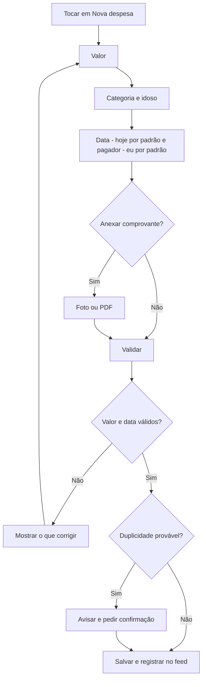
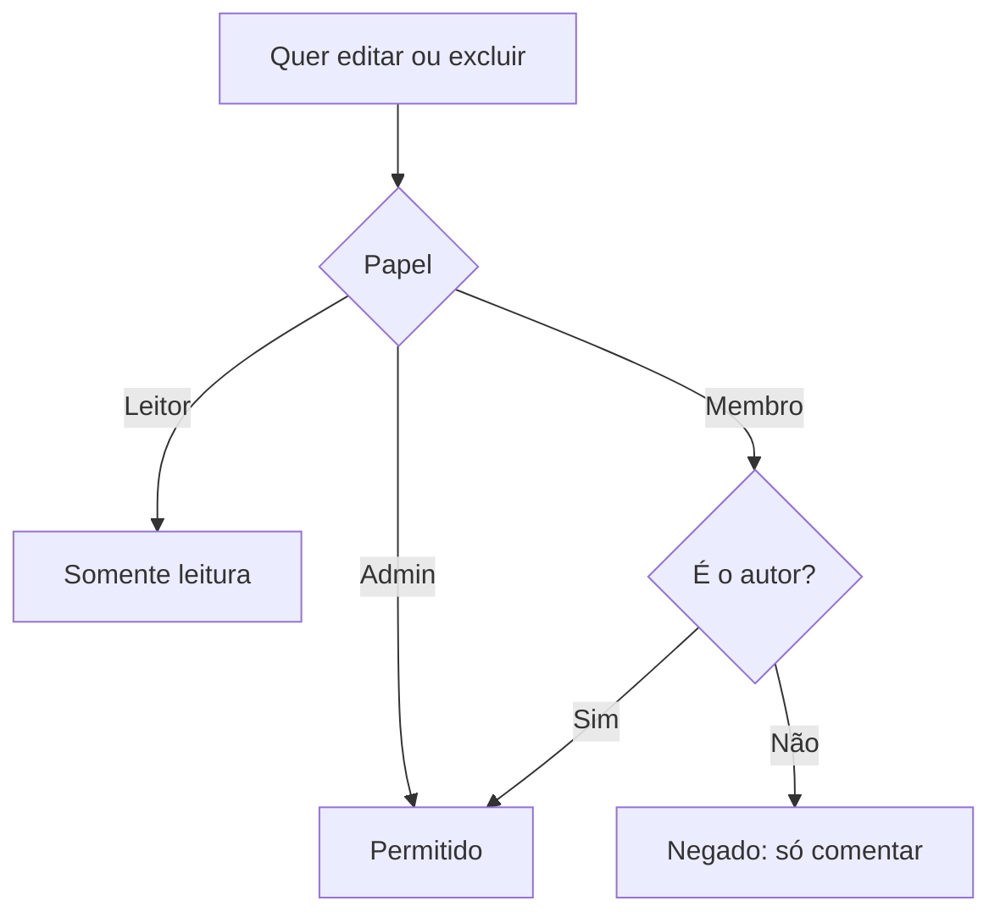

# Especificação: Registro de Despesas

**Branch**: `004-registro-de-despesas` | **Criada**: 2026-11-13 | **Status**: Rascunho para revisão

**Entrada**: "Lançamento de gastos do cuidado (farmácia, consultas, transporte), com categorias, comprovante, quem pagou e relatórios. **Sem divisão de despesas nem saldo entre familiares no MVP.**" Depende de 001; opcionalmente liga com 002 e 003.

## Cenários de Usuário e Testes *(obrigatório)*

### História 1 — Lançar uma despesa rapidamente (Prioridade: P1)

Depois de pagar a farmácia ou uma consulta, o familiar registra o gasto em poucos toques, com foto do comprovante.

**Por que P1:** é o núcleo do controle de despesas e responde à dor "dificuldade para acompanhar os gastos".

**Teste independente:** lançar uma despesa de farmácia com comprovante em menos de 30 segundos e vê-la na lista.

**Cenários de aceite:**

1. **Dado** que sou Membro ou Admin, **quando** informo valor, categoria e idoso (data de hoje e pagador "eu" vêm preenchidos), **então** a despesa é salva e aparece na lista e no feed.
2. **Dado** o formulário de despesa, **quando** tiro foto do comprovante ou anexo PDF, **então** o arquivo é guardado junto da despesa.
3. **Dado** um valor zero, negativo ou acima de R$ 9.999.999,99, **quando** tento salvar, **então** o app impede e explica o motivo.
4. **Dado** uma data futura, **quando** tento salvar, **então** o app impede ("só é possível lançar gastos já realizados").
5. **Dado** que o último lançamento foi igual (mesma data, valor, categoria e idoso), **quando** salvo outro idêntico, **então** o app avisa sobre possível duplicidade e deixa confirmar.
6. **Dado** que sou Leitor, **quando** abro as despesas, **então** posso ver, mas não lançar nem editar.

---

### História 2 — Ver e filtrar as despesas (Prioridade: P1)

O familiar consulta a lista e o total por mês, filtrando por idoso, categoria e pagador.

**Por que P1:** de nada adianta registrar sem poder consultar; entrega a "transparência no controle de despesas".

**Teste independente:** com despesas de vários idosos e categorias, conferir o total do mês e os filtros.

**Cenários de aceite:**

1. **Dado** despesas registradas, **quando** abro "Despesas", **então** vejo o total do mês atual e a lista em ordem de data (mais recente primeiro).
2. **Dado** a lista, **quando** filtro por idoso, categoria, pagador ou período, **então** a lista e o total refletem o filtro.
3. **Dado** que mudo o mês, **quando** navego para o mês anterior, **então** vejo o total e a lista daquele mês.
4. **Dado** uma despesa, **quando** a abro, **então** vejo todos os dados, o comprovante, quem lançou e quando, e o histórico de alterações.

---

### História 3 — Relatórios e exportação (Prioridade: P2)

O familiar vê quanto se gastou por categoria, por idoso e por pagador, e exporta os dados.

**Por que P2:** completa o controle financeiro e ajuda em prestação de contas e imposto de renda, mas a lista já resolve o básico.

**Teste independente:** gerar o relatório de um trimestre e exportar o CSV, conferindo os totais.

**Cenários de aceite:**

1. **Dado** um período, **quando** abro "Relatórios", **então** vejo totais por categoria, por idoso e por pagador, com gráfico simples e a variação em relação ao período anterior.
2. **Dado** o relatório, **quando** toco em "Exportar", **então** recebo um CSV com uma linha por despesa e os links dos comprovantes são omitidos (só o indicador "tem comprovante").
3. **Dado** que exporto, **quando** o arquivo é gerado, **então** abre-se o menu de compartilhamento do aparelho.
4. **Dado** o relatório por pagador, **quando** vejo os valores, **então** o app deixa claro que é apenas um registro informativo, sem cálculo de quem deve a quem.

---

### História 4 — Editar, excluir e categorias próprias (Prioridade: P2)

O autor corrige um lançamento; o Admin ajusta categorias e pode corrigir qualquer lançamento.

**Por que P2:** erros acontecem; depois do uso básico isso faz diferença.

**Teste independente:** editar uma despesa como autor, tentar editar a de outro membro, e criar uma categoria própria.

**Cenários de aceite:**

1. **Dado** que sou o autor da despesa, **quando** edito valor, categoria ou comprovante, **então** a alteração é salva e o histórico guarda valores antigos e novos.
2. **Dado** que sou Membro e não sou o autor, **quando** tento editar, **então** só posso comentar; apenas o Admin edita lançamentos de outros.
3. **Dado** uma despesa, **quando** a excluo, **então** ela vai para a lixeira por 30 dias e deixa de entrar nos totais, podendo ser restaurada.
4. **Dado** que sou Admin, **quando** crio uma categoria própria (ex.: "Cuidadora de fim de semana"), **então** ela fica disponível para toda a família.
5. **Dado** uma categoria em uso, **quando** o Admin a arquiva, **então** ela some da escolha, mas as despesas antigas mantêm a categoria.

---

### História 5 — Vincular despesa a compromisso, medicamento ou documento (Prioridade: P3)

O familiar liga o gasto a uma consulta, a um medicamento comprado ou a uma nota anexada em documentos.

**Por que P3:** dá contexto, mas é opcional.

**Teste independente:** criar uma despesa ligada a uma consulta e abrir a consulta vendo o gasto associado.

**Cenários de aceite:**

1. **Dado** o formulário de despesa, **quando** escolho "vincular a" e seleciono um compromisso, **então** a despesa aparece no detalhe do compromisso.
2. **Dado** que vinculei a um medicamento, **quando** abro o histórico dele, **então** vejo as compras relacionadas.

---

### Casos de Borda

- Despesa do "geral da família" (ex.: assinatura de plano familiar): permitida sem idoso, categoria própria e filtro "Sem idoso específico".
- Pagador que foi removido da família: o nome permanece nas despesas antigas (regra RN-FAM-11).
- Valor digitado com vírgula ou ponto: o app aceita o formato brasileiro e normaliza.
- Despesa em outra moeda: fora do MVP; tudo em reais.
- Comprovante grande: segue o limite de 20 MB e a cota da feature 002.
- Edição simultânea por Admin e autor: vence a última, com histórico completo.
- Lançamento retroativo de meses antigos: permitido a qualquer data passada.
- Idoso arquivado: despesas antigas continuam nos relatórios; novos lançamentos ficam bloqueados para esse idoso.
- Pagador "o próprio idoso" ou "outra pessoa": aceito, útil para registrar gastos pagos pela aposentadoria do idoso ou por terceiros.

## Requisitos *(obrigatório)*

### Requisitos Funcionais

- **FR-001**: O sistema DEVE permitir lançar despesa com valor (BRL), data, categoria, idoso (ou "geral"), pagador, forma de pagamento opcional, descrição opcional e comprovante opcional.
- **FR-002**: O sistema DEVE oferecer categorias padrão: Farmácia, Consulta, Exame, Plano de saúde, Terapias, Transporte, Cuidador/Home care, Alimentação especial, Fraldas e higiene, Equipamentos, Moradia/Instituição, Outros.
- **FR-003**: O sistema DEVE permitir ao Admin criar, renomear e arquivar categorias.
- **FR-004**: O sistema DEVE permitir indicar o pagador entre os membros, "o próprio idoso" ou "outra pessoa" (nome livre).
- **FR-005**: O sistema DEVE listar despesas por mês com total e filtros por idoso, categoria, pagador e período.
- **FR-006**: O sistema DEVE gerar relatórios de totais por categoria, idoso e pagador, com variação em relação ao período anterior.
- **FR-007**: O sistema DEVE exportar despesas em CSV.
- **FR-008**: O sistema DEVE permitir editar e excluir despesas conforme RN-DES-04, com histórico de alterações.
- **FR-009**: O sistema DEVE avisar sobre possível duplicidade.
- **FR-010**: O sistema DEVE permitir vincular uma despesa a compromisso, medicamento ou documento.
- **FR-011**: O sistema DEVE registrar lançamentos, alterações e exclusões no feed da família.
- **FR-012**: O sistema NÃO DEVE calcular divisão de despesas, saldos nem acertos entre familiares (fora do MVP).
- **FR-013**: O sistema DEVE manter excluídos na lixeira por 30 dias com restauração.

### Regras de Negócio

| ID | Regra |
|---|---|
| RN-DES-01 | Valores em reais, armazenados em centavos. Mínimo R$ 0,01, máximo R$ 9.999.999,99. |
| RN-DES-02 | A data da despesa não pode ser futura. Retroativa é permitida. |
| RN-DES-03 | Admin e Membro lançam. Leitor só visualiza e exporta. |
| RN-DES-04 | O autor edita e exclui os próprios lançamentos. O Admin edita e exclui qualquer um. Membro não edita lançamento de outro membro. |
| RN-DES-05 | Cada alteração guarda o valor anterior (histórico imutável) com autor e data. |
| RN-DES-06 | Excluídas vão para a lixeira por 30 dias e não entram em totais nem relatórios. |
| RN-DES-07 | O pagador é um membro da família, "o próprio idoso" ou "outra pessoa" com nome livre. Não há cálculo de dívida entre pagadores. |
| RN-DES-08 | Duplicidade provável: mesma data, valor, categoria e idoso; apenas aviso. |
| RN-DES-09 | Categorias padrão não podem ser excluídas, só ocultadas pelo Admin. Categorias próprias podem ser arquivadas, nunca excluídas se houver despesas. |
| RN-DES-10 | Totais do mês usam a data da despesa no fuso da família. |
| RN-DES-11 | Exportação CSV inclui: data, categoria, idoso, pagador, valor, descrição, forma de pagamento, "tem comprovante". Separador `;`, decimal vírgula, codificação UTF-8 com BOM para abrir no Excel brasileiro. |
| RN-DES-12 | Despesas de idoso arquivado continuam nos relatórios. Novos lançamentos para ele são bloqueados. |
| RN-DES-13 | A visibilidade das despesas segue o papel: todos os membros ativos, inclusive Leitor, veem valores (permissão por módulo está fora do MVP). |
| RN-DES-14 | Cada lançamento é registrado na trilha de auditoria; exportações também. |

### Entidades-Chave

- **Despesa:** valor, data, categoria, idoso (opcional), pagador, forma de pagamento, descrição, comprovante, vínculos, autor, situação (ativa/na lixeira).
- **Categoria:** nome, tipo (padrão/própria), situação (ativa/oculta/arquivada).
- **Pagador:** membro, "idoso" ou "outra pessoa" com nome.
- **Histórico de alteração:** campo, valor anterior, novo valor, autor, data.
- **Vínculo:** despesa ligada a compromisso, medicamento ou documento.

## Fluxos

### Lançar despesa

### Permissões de edição

## Critérios de Sucesso *(obrigatório)*

- **SC-001**: Lançar uma despesa (valor, categoria, idoso) leva menos de 30 segundos e no máximo 3 toques depois do formulário aberto, com os padrões preenchidos.
- **SC-002**: 90% dos usuários encontram o total do mês corrente e de uma categoria em menos de 20 segundos.
- **SC-003**: Famílias ativas registram em média pelo menos 4 despesas por mês.
- **SC-004**: O total do relatório confere com a soma da lista em 100% dos casos (teste automatizado).
- **SC-005**: A exportação CSV abre corretamente no Excel e no Google Planilhas em português.

## Decisões assumidas e pontos em aberto

1. **Sem divisão e sem saldo** (decisão do dono do produto). O relatório por pagador é informativo; a divisão fica como evolução futura natural.
2. **Leitor vê valores** (RN-DES-13). Despesas são sensíveis entre irmãos; avaliar permissão por módulo no pós-MVP.
3. **Despesas previstas** (futuras ou recorrentes, como mensalidade do plano) ficam fora do MVP.
4. **Forma de pagamento** como campo livre de lista curta (dinheiro, Pix, débito, crédito, boleto, outro).
5. **Comentários em despesas** serão tratados na feature 005 (feed e comentários); aqui só se prevê o gancho.
6. **Notas fiscais para IR:** exportação de relatório anual específico para imposto de renda fica para depois.

## Premissas

- O usuário já fez o pagamento por fora do app; o EloSenior não processa pagamentos.
- O armazenamento de comprovantes reaproveita o mecanismo de arquivos da feature 002 (mesma cota de 1 GB por família).
