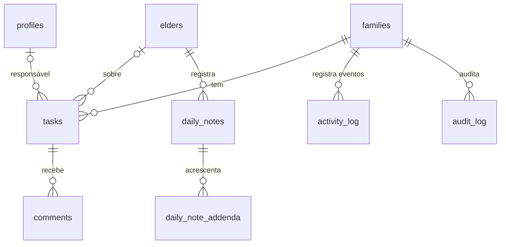

# Modelo de Dados: Tarefas e Atualizações

Segue as convenções de `specs/001-familia-e-acesso/data-model.md`. `notification_preferences` e `reminders` estão definidas em `specs/003-agenda-e-lembretes/data-model.md`; esta feature só acrescenta categorias.

## Tabelas

### `tasks`
| Coluna | Tipo | Regra |
|---|---|---|
| id, family_id | | |
| elder_id | uuid FK `elders` | opcional |
| title | text NOT NULL | 1 a 140 caracteres |
| description | text | até 2000 caracteres |
| assignee_id | uuid FK `profiles` | nulo = em aberto (RN-TAR-02) |
| due_on | date | opcional |
| priority | enum `normal`, `high` | |
| status | enum `open`, `in_progress`, `done`, `cancelled` | RN-TAR-03 |
| completed_by, completed_at | | reabertura permitida em até 24 h |
| link_type, link_id | | opcional: compromisso, medicamento, despesa, documento |
| auditoria, deleted_at | | |

### `daily_notes`
`id`, `family_id`, `elder_id`, `author_id`, `body` (≤ 2000), `mood` (`good`, `fair`, `bad`, opcional), `created_at`, `locked_at` (= `created_at + 24 h`). Notas posteriores em `daily_note_addenda` (`id`, `daily_note_id`, `author_id`, `body`, `created_at`).

### `comments`
`id`, `family_id`, `parent_type` (`task`, `appointment`, `expense`, `daily_note`), `parent_id`, `author_id`, `body` (≤ 1000), `mentions` (uuid[]), `created_at`, `edited_at`, `removed_at`.

### `activity_log` (imutável)
| Coluna | Tipo | Regra |
|---|---|---|
| id | bigint identity | cursor de paginação |
| family_id | uuid | |
| occurred_at | timestamptz | |
| actor_id | uuid | nulo se o autor excluiu a conta (exibe "Ex-membro") |
| actor_name | text | nome no momento do evento |
| module | enum `family`, `health`, `agenda`, `expenses`, `tasks` | |
| type | text | ex.: `dose.confirmed`, `task.completed`, `expense.created` |
| elder_id | uuid | opcional |
| object_type, object_id | | referência ao objeto (pode já ter sido excluído) |
| summary | text | resumo em português, texto simples |

Sem `UPDATE` nem `DELETE` para nenhum papel (privilégios revogados e gatilho de bloqueio).

### `audit_log` (imutável)
`id`, `family_id`, `occurred_at`, `user_id`, `action` (`view`, `download`, `share`, `create`, `update`, `delete`, `export`), `object_type`, `object_id`, `meta` (jsonb). Retenção: 24 meses (RN-TAR-14). Leitura: Admin.

### Categorias de notificação (extensão)
Valores de `notification_preferences.category`: `dose`, `dose_escalation`, `appointment`, `prescription`, `stock`, `task`, `activity`, `comment_mention`. Campos adicionais: `daily_digest` (boolean, só para `activity`).

## Funções

| Função | Uso |
|---|---|
| `log_activity(family_id, type, module, elder_id, object_type, object_id, summary)` | única porta de entrada do feed; chamada por todas as RPCs |
| `care_load(family_id, from, to)` | por membro: tarefas abertas, concluídas (30 dias), compromissos acompanhados (próx. 30 dias), doses confirmadas |
| `feed(family_id, cursor, limit, filters)` | página de eventos mais antigos que o cursor, com agrupamento por (autor, módulo, tipo, janela de 10 min) |

## Diagrama

## RLS (resumo)

| Tabela | SELECT | INSERT | UPDATE/DELETE |
|---|---|---|---|
| tasks, daily_notes, comments | membro ativo | Admin/Membro | tarefa: Admin/Membro; comentário: autor (≤ 15 min) ou Admin remove |
| activity_log | membro ativo | somente `log_activity()` | nenhum |
| audit_log | Admin | somente gatilhos/RPC | nenhum |

Testes pgTAP: nenhum papel consegue alterar ou apagar `activity_log`; Leitor não cria tarefas nem comentários; teste de cobertura confirma que cada RPC `SECURITY DEFINER` grava evento.
