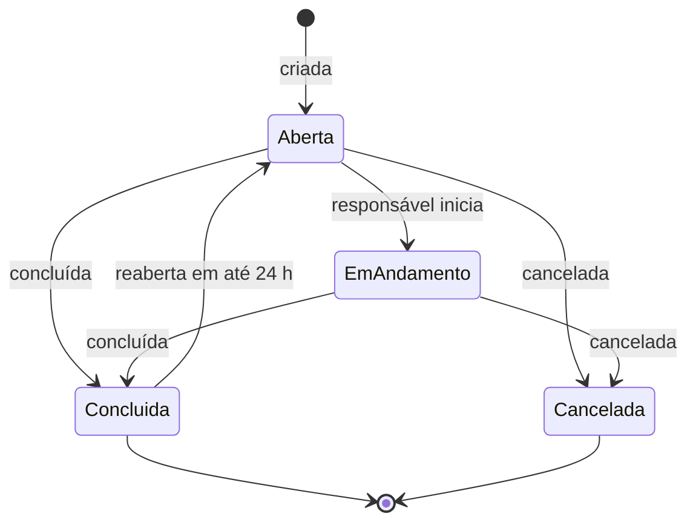
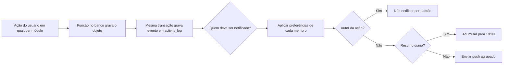
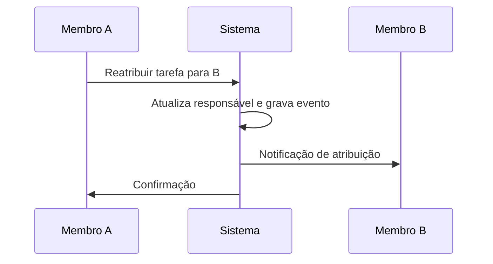

# Especificação: Tarefas e Atualizações

**Branch**: `005-tarefas-e-atualizacoes` | **Criada**: 2026-11-13 | **Status**: Rascunho para revisão

**Entrada**: "Tarefas com responsável e prazo, distribuição de responsabilidades, feed de atividades da família, registro do dia, notificações de mudanças." Depende de 001 e se liga às features 002, 003 e 004 (todas gravam no feed).

## Cenários de Usuário e Testes *(obrigatório)*

### História 1 — Criar tarefas e atribuir responsáveis (Prioridade: P1)

Um familiar cria uma tarefa (ex.: "Buscar remédio na farmácia"), define responsável e prazo, e acompanha até a conclusão.

**Por que P1:** é a resposta direta às dores "sobrecarga de um único familiar" e "divisão injusta das responsabilidades".

**Teste independente:** criar uma tarefa, atribuí-la a outro membro, que a conclui. O criador vê a conclusão.

**Cenários de aceite:**

1. **Dado** que sou Membro ou Admin, **quando** crio uma tarefa com título, e opcionalmente idoso, responsável, prazo e descrição, **então** ela aparece na lista da família.
2. **Dado** uma tarefa atribuída a outro membro, **quando** salvo, **então** o responsável é notificado.
3. **Dado** uma tarefa sem responsável, **quando** um membro toca em "Eu faço", **então** ele se torna o responsável e os outros veem no feed.
4. **Dado** que sou o responsável, **quando** marco a tarefa como concluída, **então** ela sai da lista de abertas, o criador é notificado e a conclusão aparece no feed com autor e hora.
5. **Dado** uma tarefa com prazo, **quando** chega o dia do prazo, **então** o responsável recebe um lembrete pela manhã (08:00 no fuso da família).
6. **Dado** uma tarefa vencida há mais de 48 horas, **quando** o prazo é cruzado, **então** os Admins são avisados uma vez.
7. **Dado** que sou Leitor, **quando** abro as tarefas, **então** vejo tudo, mas não crio nem altero.

---

### História 2 — Acompanhar o feed de atividades da família (Prioridade: P1)

Todos os membros veem, em ordem cronológica, o que aconteceu: doses confirmadas, consultas agendadas, documentos anexados, despesas lançadas, tarefas concluídas, mudanças de membros.

**Por que P1:** é o que resolve "falhas na comunicação entre familiares" e dá a tranquilidade de acompanhar à distância (princípio IV).

**Teste independente:** realizar ações em vários módulos e conferir que o feed mostra cada uma, com autor e hora, e permite filtrar.

**Cenários de aceite:**

1. **Dado** qualquer ação registrada pelo app (criar, editar, excluir, confirmar dose, concluir tarefa...), **quando** ela acontece, **então** aparece no feed com autor, hora, idoso relacionado e um resumo curto.
2. **Dado** o feed, **quando** filtro por idoso, módulo (saúde, agenda, despesas, tarefas, família) ou membro, **então** vejo só o que corresponde.
3. **Dado** um item do feed, **quando** toco nele, **então** abro o objeto relacionado (se ainda existir e se eu tiver acesso).
4. **Dado** que um objeto foi excluído, **quando** vejo o feed, **então** o evento permanece e informa "[nome] excluiu [objeto]".
5. **Dado** que sou Leitor, **quando** abro o feed, **então** vejo tudo, sem ações de edição.
6. **Dado** eventos antigos, **quando** rolo a lista, **então** o app carrega mais itens por página, sem travar.

---

### História 3 — Ver quem está fazendo o quê (Prioridade: P2)

Uma tela mostra, por membro, quantas tarefas abertas e quantos compromissos acompanha, para a família ajustar a divisão de responsabilidades.

**Por que P2:** transforma o feed em ação, mas só faz sentido com tarefas e agenda em uso.

**Teste independente:** com tarefas e compromissos distribuídos desigualmente entre três membros, a tela mostra a diferença.

**Cenários de aceite:**

1. **Dado** tarefas abertas e compromissos acompanhados, **quando** abro "Divisão do cuidado", **então** vejo por membro: tarefas abertas, tarefas concluídas nos últimos 30 dias, compromissos acompanhados nos próximos 30 dias e doses confirmadas.
2. **Dado** a tela, **quando** toco em um membro, **então** vejo a lista de itens dele.
3. **Dado** uma tarefa na lista de um membro, **quando** sou Admin ou Membro e toco em "Reatribuir", **então** posso passá-la para outra pessoa, que é notificada.
4. **Dado** que um membro concentra mais de 60% dos itens e a família tem ao menos 3 membros ativos, **quando** abro a tela, **então** vejo uma sugestão neutra "A carga está concentrada em [nome]. Que tal dividir?" (informativa, sem julgamento).

---

### História 4 — Registro do dia (Prioridade: P2)

Quem cuida do idoso anota como foi o dia ("Dormiu bem, almoçou tudo, pressão 12 por 8") e os demais acompanham à distância.

**Por que P2:** atende ao "acompanhamento da rotina de cuidados, mesmo à distância", e é simples.

**Teste independente:** criar um registro, vê-lo no feed e na ficha do idoso, e comentar.

**Cenários de aceite:**

1. **Dado** que sou Membro ou Admin, **quando** escrevo um registro do dia para um idoso (texto, humor opcional: bem, regular, mal), **então** ele é salvo e aparece no feed e no histórico do idoso.
2. **Dado** um registro, **quando** outro membro comenta, **então** o autor é notificado.
3. **Dado** um registro com mais de 24 horas, **quando** o autor tenta editá-lo, **então** só pode acrescentar uma nota; o texto original permanece.
4. **Dado** o histórico do idoso, **quando** filtro por período ou humor, **então** a lista é filtrada.

---

### História 5 — Comentar em tarefas, compromissos e despesas (Prioridade: P3)

Os membros discutem dentro do item, em vez de usar o WhatsApp.

**Por que P3:** reduz mensagens externas, mas o essencial já funciona sem comentários.

**Teste independente:** comentar em uma tarefa e ver o comentário no feed para o responsável.

**Cenários de aceite:**

1. **Dado** uma tarefa, compromisso, despesa ou registro do dia, **quando** escrevo um comentário, **então** ele aparece abaixo do item e os envolvidos (autor, responsável, acompanhante) são notificados.
2. **Dado** que mencionei um membro com "@", **quando** envio, **então** ele recebe notificação direta.
3. **Dado** que sou Leitor, **quando** abro um item, **então** vejo os comentários, mas não escrevo.

---

### História 6 — Escolher quais notificações receber (Prioridade: P2)

Cada pessoa decide o que quer receber, para não ser sobrecarregada.

**Por que P2:** evita que o excesso de notificações faça o usuário desligar tudo (o que comprometeria os lembretes de dose da feature 003).

**Teste independente:** desativar a categoria "atividades" e continuar recebendo lembretes de doses.

**Cenários de aceite:**

1. **Dado** a tela de preferências, **quando** desativo uma categoria, **então** deixo de receber só ela, e não as demais.
2. **Dado** que não quero ser avisado das minhas próprias ações, **quando** faço algo, **então** não recebo notificação do que eu mesmo fiz (padrão).
3. **Dado** que ativei o resumo diário, **quando** chega 19:00, **então** recebo uma única notificação com o resumo do dia em vez de uma por evento (categoria atividade).
4. **Dado** que desativei as notificações de lembrete de dose, **quando** tento salvar, **então** o app avisa do risco e pede confirmação (princípio V).

---

### Casos de Borda

- Tarefa atribuída a membro removido: passa a "sem responsável" e o criador e os Admins são avisados.
- Tarefa concluída por engano: o responsável pode reabrir em até 24 h; depois, cria outra.
- Muitos eventos em curto tempo (ex.: 20 despesas lançadas em sequência): o feed agrupa eventos do mesmo autor, módulo e janela de 10 minutos ("Ana lançou 20 despesas").
- Evento de objeto com dado sensível (ex.: nome de medicamento): o feed mostra o nome (todos da família já têm acesso), mas a notificação segue a preferência "ocultar detalhes na tela bloqueada".
- Comentário em item excluído: bloqueado; o histórico permanece visível.
- Idoso arquivado: tarefas abertas dele são encerradas como "canceladas"; registros do dia passam a somente leitura.
- Edição simultânea de tarefa: a última gravação vence e o feed registra ambas as mudanças.
- Autor da ação removido da família: eventos mostram o nome dele; se excluiu a conta, "Ex-membro".

## Requisitos *(obrigatório)*

### Requisitos Funcionais

- **FR-001**: O sistema DEVE permitir criar, editar, concluir, reabrir, reatribuir e cancelar tarefas com título, descrição, idoso opcional, responsável opcional, prazo opcional e prioridade (normal, alta).
- **FR-002**: O sistema DEVE permitir "Eu faço" em tarefas sem responsável.
- **FR-003**: O sistema DEVE notificar atribuição, conclusão, prazo do dia e vencimento prolongado de tarefas.
- **FR-004**: O sistema DEVE manter um registro imutável de atividades (feed) alimentado automaticamente por todas as features.
- **FR-005**: O sistema DEVE permitir filtrar o feed por idoso, módulo e membro, com paginação.
- **FR-006**: O sistema DEVE agrupar eventos repetitivos do mesmo autor e módulo em janela de 10 minutos.
- **FR-007**: O sistema DEVE oferecer a tela "Divisão do cuidado" com cargas por membro.
- **FR-008**: O sistema DEVE permitir registros do dia com texto, humor opcional e comentários.
- **FR-009**: O sistema DEVE permitir comentários em tarefas, compromissos, despesas e registros do dia, com menção "@".
- **FR-010**: O sistema DEVE permitir configurar notificações por categoria, resumo diário e ocultar detalhes na tela bloqueada.
- **FR-011**: O sistema DEVE evitar notificar o autor da própria ação (padrão).
- **FR-012**: O sistema DEVE alertar ao desativar lembretes de dose.
- **FR-013**: O sistema DEVE preservar eventos do feed mesmo após exclusão do objeto relacionado.
- **FR-014**: O sistema DEVE manter trilha de auditoria separada do feed, com acessos e alterações a dados de saúde.

### Regras de Negócio

| ID | Regra |
|---|---|
| RN-TAR-01 | Admin e Membro criam, editam e comentam. Leitor só visualiza o feed, as tarefas e os comentários. |
| RN-TAR-02 | Uma tarefa tem no máximo um responsável. Sem responsável é permitido ("em aberto") e qualquer Admin ou Membro pode assumir. |
| RN-TAR-03 | Status de tarefa: aberta, em andamento, concluída, cancelada. Concluída pode ser reaberta pelo responsável ou Admin em até 24 h. |
| RN-TAR-04 | Lembrete de prazo: 08:00 do dia do prazo (fuso da família) ao responsável. Tarefa vencida há 48 h avisa os Admins uma vez. |
| RN-TAR-05 | O feed é imutável: eventos não são editados nem excluídos por usuários. Mostra os últimos 12 meses; eventos mais antigos saem da tela, mas permanecem na auditoria. |
| RN-TAR-06 | Todo evento registra: tipo, autor, data/hora, módulo, idoso (se houver), objeto e resumo em texto simples. |
| RN-TAR-07 | Eventos do mesmo autor, módulo e tipo dentro de 10 minutos são exibidos agrupados. O armazenamento mantém cada evento. |
| RN-TAR-08 | Distribuição: carga por membro = tarefas abertas atribuídas + compromissos acompanhados nos próximos 30 dias. A sugestão de concentração aparece quando um membro tem mais de 60% da carga total e há 3 ou mais membros ativos. É informativa. |
| RN-TAR-09 | Registro do dia: texto de até 2000 caracteres; humor opcional (bem, regular, mal). Depois de 24 h, só se acrescentam notas; o original permanece. Não há campos clínicos estruturados no MVP (pressão, glicemia etc. ficam para depois). |
| RN-TAR-10 | Comentários: texto de até 1000 caracteres; menção a membro ativo gera notificação direta. Comentários não são editáveis após 15 minutos. Podem ser apagados pelo autor ou Admin, deixando "comentário removido". |
| RN-TAR-11 | Notificações por categoria: lembretes de dose, compromissos, tarefas, atividades, receitas e estoque. O autor da ação não é notificado dela por padrão. Resumo diário opcional às 19:00 só para a categoria "atividades". |
| RN-TAR-12 | Desativar "lembretes de dose" exige confirmação explícita e é registrado. Nada impede o usuário de desativar, mas o aviso persistente da feature 003 passa a valer. |
| RN-TAR-13 | Idoso arquivado: tarefas abertas dele são canceladas automaticamente, com registro no feed. |
| RN-TAR-14 | Trilha de auditoria (acessos e alterações em dados de saúde) é distinta do feed, visível só a Admin e retida por 24 meses. |
| RN-TAR-15 | Membro removido: tarefas dele viram "em aberto"; eventos e comentários permanecem com o nome (ou "Ex-membro" se excluiu a conta). |

### Entidades-Chave

- **Tarefa:** título, descrição, idoso opcional, responsável, criador, prazo, prioridade, status, vínculos opcionais.
- **Evento de atividade:** tipo, autor, data/hora, módulo, idoso, objeto, resumo.
- **Registro do dia:** idoso, autor, texto, humor, notas posteriores.
- **Comentário:** objeto pai, autor, texto, menções.
- **Preferência de notificação:** categoria, ligada/desligada, resumo diário, ocultar detalhes. (Estrutura compartilhada com a feature 003.)
- **Auditoria:** quem, quando, o que foi acessado ou alterado.

## Fluxos

### Ciclo da tarefa

### Como um evento chega ao feed e às notificações

### Reatribuição pela tela de divisão

## Critérios de Sucesso *(obrigatório)*

- **SC-001**: Pelo menos 30% das tarefas concluídas são feitas por membros que não são o cuidador principal (métrica M4).
- **SC-002**: Criar e atribuir uma tarefa leva menos de 30 segundos.
- **SC-003**: 100% das ações dos módulos 001 a 004 geram evento no feed (teste automatizado por função).
- **SC-004**: Menos de 20% dos usuários desativam a categoria de lembretes de dose.
- **SC-005**: Pelo menos 60% das famílias com 2+ membros abrem o feed semanalmente.
- **SC-006**: O feed carrega os primeiros 30 eventos em menos de 1 segundo.

## Decisões assumidas e pontos em aberto

1. **Retenção do feed em 12 meses e auditoria em 24 meses** são hipóteses. Validar com assessoria jurídica (LGPD).
2. **Limiar de 60%** para a sugestão de concentração é arbitrário. Testar em campo; risco de parecer cobrança entre irmãos, daí o texto neutro.
3. **Sinais vitais estruturados** (pressão, glicemia, peso) ficam fora; o Registro do dia é texto livre. Avaliar depois com base no uso.
4. **Menções "@"** entram como P3. Confirmar se vale para o MVP.
5. **Recorrência de tarefas** (ex.: comprar fraldas todo mês) fica fora do MVP.
6. **Resumo diário às 19:00** é um padrão fixo no MVP.

## Premissas

- A infraestrutura de push e preferências é a da feature 003; esta feature adiciona categorias de notificação.
- As funções de banco de todas as features gravam no `activity_log` na mesma transação (contrato definido em `contracts/api.md`).
